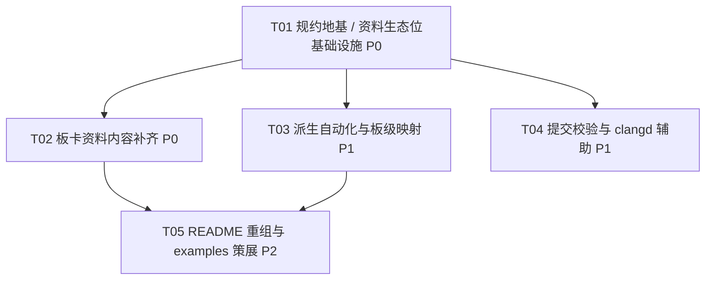

# 借鉴 XPulse minimal 模板的工作计划（供审阅，不实施）

> **文档定位**：这是一份**决策文档**，用于用户审阅后决定是否实施。文中所有「新增文件 / 目标文件 / 任务」都是**后续实施阶段的候选**，本轮均不存在。
> **拍板状态**：**§5.3 的 Q1–Q14 已于 2026-11-04 全部逐条拍板，结果见 5.3.1**；凡本文其它章节与 5.3.1 冲突，以 5.3.1 为准。
> **本轮状态**：产出本文件 + 按 Q1 修复 `.vscode/launch.json` 的 3 条失效路径；未移植、未下载资料、未执行任何 Git 操作、未构建、未实板。
> **判定深度**：按用户确认，为「思想 + 架构 + 工具链评估」，逐项给出「可借鉴 / 需适配 / 不适合 F103 模板」并写明为什么。
> **验证等级**：本计划文档本身属 **L0（只读核对）/ L1（人工一致性核对）**，见第 4 章。

---

## 0. 前置事实与假设

### 0.1 两仓边界与路径

| 仓 | 绝对路径 | 角色 | 本轮可写性 |
| -- | -------- | ---- | ---------- |
| **A（本工程）** | `D:\Projects\GitHub\template-mcu-STM32F103C8T6-BluePill` | STM32F103C8T6 Blue Pill 最小工程模板；STM32CubeMX + PlatformIO + VS Code；**无 Node 工具链** | **唯一可写**；且本轮只允许写 `docs/PLAN-borrow-xpulse.md` 这一个文件 |
| **B（参考）** | `D:\Projects\GitHub\template-mcu-minimal-STM32G474VET6-XPulse` | STM32G474VET6 / XPulse 板最小模板，只读素材来源 | **全程只读，禁止任何写操作** |

> 命名说明：本文的「A / B」是本次任务的编号。**B 仓自带的 `docs/PLAN-a2b-migration.md` 里也用了 A / B，但那是 B 自己的另一套编号，两者不是同一套，勿混用。**

### 0.2 本轮改名已完成但未提交

- 仓库与远端已统一改名为 `-BluePill` 后缀；GitHub 私有仓库为 `LeonhardtHUST/template-mcu-STM32F103C8T6-BluePill`，origin 已切换为 SSH 新地址。
- **未提交**。改名环节涉及 4 项 ` M` 改动；此外本轮另新增 1 个**未跟踪**文件 `docs/PLAN-borrow-xpulse.md`（本计划），故当前 `git status --porcelain` 共 5 项：
  - 本轮改名产生：`README.md`、`TEMPLATE-PLACEHOLDERS.md`（A3 / A4 与标题改为新名）；
  - **用户既有未提交改动**：`.vscode/extensions.json`、`.vscode/launch.json`；
  - 本计划文档（未跟踪，见 0.4）。
- **精确表述（QA 实测）**：`.vscode/launch.json` 第 72 / 86 / 96 行指向改名前旧目录的三条 `executable` 路径，**不是 HEAD 里原有的内容，而是用户未提交改动中新增的 `+` 行** —— 本轮改名前已存在于工作区，但 HEAD 中原本没有。证据：`git show HEAD:.vscode/launch.json | grep template-mcu` 无命中，`git diff -- .vscode/` 中显示为新增行。QA 另实测：旧目录**确实不存在**、新目录下 `firmware.elf` **确实存在** → 副作用等级为 **「确定失效」**，不是「可能找不到 elf」。**2026-11-04 更新**：用户已拍板 Q1 = (a) 并授权执行，3 条 `executable` 已改为 `${workspaceFolder}/.pio/build/genericSTM32F103C8/firmware.elf`（JSONC 校验通过、旧路径残留 0）。QA 原判定「Known Issue 而非改名遗漏」仍成立；这是本轮对用户既有未提交改动的**唯一**修改。
- 这 4 项改动须保留供审阅（Q1 的 3 行已按用户授权修改），**不得**用 `git checkout --` / `git restore` 覆盖；本轮不提交 git。

### 0.3 用户四项确认

1. 仓库与远端已统一改名为 `-BluePill`（本轮已执行，**未提交**）。
2. 借鉴深度 = **思想 + 架构 + 工具链评估**，逐项标注「可借鉴 / 需适配 / 不适合 F103 模板」。
3. 工作计划**落盘到 A 的 `docs/`**（即本文件）。
4. **本轮不提交 Git**，保留工作区改动供审阅。

用户追加的重点问题：B 里 `docs/XPulse/` 这个「板卡资料生态位」在 A 里该怎么办？期望是权威 Blue Pill 资料，含**原理图**与**例程**，最好大厂官方，也考虑把 STM32F103C8T6 的 datasheet 放进来。该问题的回答见第 2 章，其可行性边界由 PM 的资料调研结论给出（见 2.4 / 2.7）。

### 0.4 本轮只出计划

不实施移植、不下载任何 PDF / 原理图 / 例程包、不改除本文件之外的任何文件、不执行 `git commit` / `git add` / `git push`、不改 origin、不装依赖、不动 `.ioc`、不触发 CubeMX 生成、不构建、不烧录。

### 0.5 借鉴的边界：A 的硬约束优先（1–11 逐条对应 `AGENTS.md` §2.1–§2.11）

任何借鉴方案都不能违反以下约束；违反即判为「不适合 F103 模板」：

1. `.ioc` 是**唯一事实来源**，引脚 / 时钟 / 外设只认 `.ioc`，`Core/` 下生成文件是产物。
2. 只允许在 `USER CODE BEGIN/END` 块内写用户代码。
3. 手改 `.ioc` 后**必须**核验：生成日志无 `Cannot map` / `OptionalMessage_ERROR`，且 `Core/Src/main.c` 有对应 `MX_xxx_Init()`。
4. `Drivers/` 与 `Makefile` **不入库**（HAL / CMSIS / 启动文件由 `framework-stm32cubef1` 提供）。
5. `Core/Src/system_stm32f1xx.c` **已从构建排除**（`build_src_filter`），不得加回。
6. **不要改 `Core/Inc/stm32f1xx_hal_conf.h` 里的用户逻辑**：该文件由 CubeMX 覆盖生成；缺哪个 `HAL_XXX_MODULE_ENABLED` 就在 `.ioc` 里加对应外设再生成。
7. **版本锁定不单独动**：`ststm32@20.0.0` / `framework-stm32cubef1@1.8.7` / `toolchain-gccarmnoneeabi@1.70201.0` / `tool-ldscripts-ststm32@0.3.0` 与 CubeMX 组成验证组合。
8. 业务逻辑与 HAL 解耦，可在主机跑的部分不依赖 HAL 头文件。
9. Git 入库 / checkout / 编辑器**统一 LF**（`.gitattributes` 的 `* text=auto eol=lf`）。
10. **自有目录用小写**（`docs/`、`scripts/`、`test/`、`release/`）；CubeMX 管理的 `Core/`、`Drivers/`、`Middlewares/`、`USB_DEVICE/` 保持工具命名与位置，**不得改名或移动**。
11. 避免 `formatOnSave` 重排生成文件（A 的 `.vscode/settings.json` 已开 `editor.formatOnSave: true`，见 `TEMPLATE-PLACEHOLDERS.md` D1）；编辑 `Core/**` 前须关闭 formatOnSave 或加格式化保护。

> 此外，`AGENTS.md` **§1** 的提交规范同样适用（**不属于 §2**）：中文 Conventional Commits（简述中文、动词开头、≤50 字、无句号）、必须写明验证等级与 Flash/RAM 数字、禁 force push / `--no-verify` / `--no-gpg-sign` / AI 署名。
>
> 追加闸门：**若引入 Node 工具链，必须论证「不影响 `pio run`、不进固件、不污染跨平台」**，并在干净（未装 Node 依赖）环境实测 `pio run` 仍通过。

### 0.6 假设

- 本计划所列两仓事实均为本地只读核验结果；`docs/XPulse/` 实测 **106 MB**。**改名前 A 的 `docs/` 已入库 3 个根级单文件**（`HAL-PITFALLS.md`、`TEMPLATE-UPDATE-AUDIT.md`、`TOOLING-cubemx.md`）；本轮另在工作区新增 1 个未跟踪的计划文档 `PLAN-borrow-xpulse.md`，2.1 目录树已把它画入 —— 二者口径不同，不矛盾。
- A 的 `.vscode/` 中 `extensions.json` / `launch.json` / `settings.json` / `tasks.json` 为已入库文件；`c_cpp_properties.json` 被 `.gitignore` 忽略（注释理由：含本机绝对路径），仅存在于本机工作区。
- `.gitattributes` 已把 `*.pdf` / `*.png` / `*.jpg` / `*.zip` / `*.elf` 等声明为 `binary`，入库后无法逐行审阅、无法产生可审 diff —— 这是第 2 章版权与体积策略的重要依据。
- **PM 的逐行资料清单已由 team-lead 正式中转并入本文第 2.7 节**（含直链、文档编号 / 版本、许可判断、体积、访问证据），以其为**唯一权威输入**；任何成员此前直接给出的口径与之冲突时以 2.7 为准（例如「8 个例程」是错误值，正确为 **14 个**）。清单中明示「未实测 / 未验证」的字段一律照实保留，不得写成已实测，也不得虚构任何 URL / 版本号 / 许可信息。失效 / 未验证台账见 **2.7.5**，本机代理限制见 **2.7.4**，已失效的 STM32duino wiki 不再作为可达主来源（见 2.3 规则⑤）。本文件已自洽，可独立审阅。

---

## 1. 双向架构对照表

### 1.0 先说方向：借鉴是双向的，不是单向照搬

B 的 `docs/PLAN-a2b-migration.md` 第 6 行白纸黑字写着「**验证等级沿用 A 的 `AGENTS.md` 口径 L0–L5**」，且其 C3 计划反过来把 A 的 `-fdata-sections` / `-Wl,--print-memory-usage` / `-Wl,-Map` 列为「增量加」。也就是说：

- **A 这一系模板是源头**：`AGENTS.md` 11 条硬约束、`TEMPLATE-PLACEHOLDERS.md` 占位符/陷阱清单、L0–L5 验证关卡、中文提交规范、严格编译选项与 map、主机回归 `test/`。
- **B 强在自动化**：`init-project.mjs` 一键改名、commitlint + hooks、clangd / 编译数据库、板级引脚映射头 `xpulse.h`、自定义 `boards/` 定义、`examples/` 策展。
- **A 强在规约与文档治理**：硬约束、生成边界记录、可审阅的 `.mxproject` diff、版本锁定、不引入运行时依赖。

因此下表中标「★」的 3 项（#11 / #12 / #13）本质上是 **A→B 的反向输出**，对 A 而言是「保持现状」，不是「借鉴」；#7 里的 `test/` 也是同类源头关系。表中「判定」回答的是：**B 的这项做法要不要引入 A**。

**判定口径**：

| 判定 | 含义 |
| ---- | ---- |
| 可借鉴 | 做法与芯片/工具链无关，且不触碰 0.5 硬约束，仅需替换名称/参数即可引入 |
| 需适配 | 思想可取，但需重新设计实现、调整清单，或必须先做技术决策（尤其是否引入 Node） |
| 不适合 F103 模板 | 与 A 硬约束冲突、为 G4 专属，或照搬会造成回归；此项应保持 A 现状（含 A 已有的更强规约） |

### 1.1 对照表

| # | 对照项 | A 现状 | B 做法 | 判定 | 理由（为什么） | 涉及文件相对路径 |
| - | ------ | ------ | ------ | ---- | -------------- | ---------------- |
| 1 | 初始化改名脚本 | 无脚本。`TEMPLATE-PLACEHOLDERS.md` A2 列出工程名**六处联动**（`.ioc` 文件名、`ProjectManager.ProjectName`、`ProjectFileName`、`.vscode/tasks.json`、`scripts/cubemx-generate.mx`、`README.md`），A3/A4 另含仓库名与 README 标题，全部人工改；A1 的 `scripts/cubemx-init.mx` 里 `__PROJECT_DIR__` 因 CubeMX 脚本不支持变量，必须硬写绝对路径 | `scripts/init-project.mjs`：自动重命名根 `.ioc`、替换 `.ioc` 内 `ProjectName`/`ProjectFileName`、同步 `README.md` / `.vscode/tasks.json` / `package.json`；支持 `--yes` / `--dry-run` / 交互式；明确告诉用户「目录名需手动改」「clangd 需重新生成索引」 | **需适配** | 思想（一键改名 + dry-run + 明确列出仍需人工项）值得借；但 ① A **无 Node 工具链**，照搬 `.mjs` 直接违反「无运行时依赖」闸门；② A 的联动名单与 B **不同**（A 多 `scripts/cubemx-generate.mx`、`README.md` 标题、仓库名、`__PROJECT_DIR__`），B 脚本还多改 `package.json`（A 没有）；③ `__PROJECT_DIR__` 是 CubeMX `.mx` 脚本的硬编码绝对路径，脚本**无法自动推断**，必须继续列为人工项，不能假装自动化。落地应选 A 已有能力（跨平台 shell/PowerShell 或 CubeMX `.mx`）或先由用户拍板 Node（见 §5 Q6）。PM 最终结论：Node 侧脚本本轮**只评估不落地** | `TEMPLATE-PLACEHOLDERS.md`、`README.md`、`scripts/cubemx-init.mx`、`scripts/cubemx-generate.mx`、`.vscode/tasks.json`、`stm32-digital-clock.ioc` |
| 2 | commitlint + Git hooks | 只有 `AGENTS.md` §1 的**中文** Conventional Commits 规范，另含「简述 ≤50 字、动词开头、无句号」「必须写明验证等级与 Flash/RAM 数字」「禁 AI 署名」「禁 `--no-verify`」；**无机器校验** | `commitlint.config.mjs`（extends `@commitlint/config-conventional`）+ `package.json` 仅 2 个 devDependencies + `pnpm-lock.yaml` + `.vite-hooks/commit-msg`（手写入库）+ `.vite-hooks/_/`（生成转发器，已忽略）；`vp hooks enable` 启用；README 明确「Node 依赖只用于提交校验，不参与固件编译」 | **需适配** | 「提交前机器拦截」的思想值得借，且 A §1.5 本来就禁 `--no-verify`，钩子是天然执行点。但 ① `config-conventional` 覆盖不了 A 的自定义规则（中文简述长度、验证等级、Flash/RAM 数字、禁 AI 署名）；② 引入 Node/pnpm/Vite+ 需过 0.5 追加闸门；③ **B 的 README 提供 `VP_GIT_HOOKS=0 git commit` 临时跳过钩子，与 A §1.5 禁止绕过校验冲突，绝不能照搬**；④ A 的 `.gitignore` 尚无 `node_modules/` 忽略项；⑤ **PM 结论：Node 工具链本轮判为「不适合」，用户确认「只评估不落地」**；**§5 Q6 已拍板后续实施阶段采用 (b) 引入 commitlint + pnpm**，故 T04 不再二选一，按 Node 方案落地（自定义规则必须单写、仍须过 0.5 追加闸门）。本轮不实施 | `AGENTS.md`、`README.md`、`.gitignore`、`commitlint.config.mjs`（候选）、`package.json`（候选）、`.vite-hooks/commit-msg`（候选） |
| 3 | clangd / 编译数据库 | 无 `compile_commands.json` / `.clangd` / clangd 脚本；`.gitignore` 已忽略 `.gcc-flags.json` 与 `.clang_complete`；`.vscode/settings.json` 开了 `formatOnSave`，`c_cpp_properties.json` 被忽略 | `scripts/clangd.mjs`（转发到 `init-clangd.sh` / `.ps1`）+ `scripts/init-clangd.sh` / `.ps1`、`disable-clangd.sh` / `.ps1`：跑 `pio run -t compiledb` 生成 `compile_commands.json` 与 `.clangd`，处理 `--query-driver`；`.gitignore` 忽略这些产物 | **可借鉴** | `pio run -t compiledb` 是 **PlatformIO 原生能力，不需要 Node**，产物可全部忽略，不进固件、不碰 `.ioc`、不触碰 0.5 硬约束。落地只需：直接提供 `.sh` / `.ps1`（**去掉 B 的 `.mjs` 转发层**）、在 `.gitignore` 补 `compile_commands.json` / `.clangd` / `.cache/`、在 README 写「换机器要重跑」。注意与 A 的 `formatOnSave` 陷阱一并说明：切 clangd 前先评估 `Core/**` 的格式化保护（D1） | `scripts/init-clangd.sh`、`scripts/init-clangd.ps1`、`scripts/disable-clangd.sh`、`scripts/disable-clangd.ps1`、`.gitignore`、`README.md`、`.vscode/settings.json`(仅说明) |
| 4 | 板级引脚映射头 | **无**。引脚信息散落在 `.ioc` 与 README，无「板上接线是死的」那层语义 | `Core/Inc/xpulse.h`（197 行）：人工维护、CubeMX 既不生成也不覆盖；`#include` 放在 `main.h` 的 `/* USER CODE BEGIN Includes */` 内所以重新生成后保留；**只描述「信号 → 引脚」**，模式 / AF / 上下拉 / 时钟仍由 `.ioc` 决定；统一 `XP_` 前缀避免与 CubeMX `GPIO_Label` 宏撞名 | **可借鉴** | 模式与芯片无关、零新依赖、零运行时代码、不违反 0.5：`.ioc` 仍是唯一事实源，头文件只做「死接线」的命名层；include 放在 USER CODE 块内正好符合 §2.2。落地改动很小：`BP_` 前缀、`#include "stm32f1xx_hal.h"`、Blue Pill 实际引脚（PC13 LED、PA13/PA14 SWD、BOOT0、HSE 8 MHz 等）。**需决定的一点**：文件放 `Core/Inc/`（沿用 B，但属 CubeMX 管理目录）还是新建小写自有目录并加 `-I`（会改 `platformio.ini` 并触发 L3）——建议沿用 `Core/Inc/` 并在文档写明「人工维护、CubeMX 不覆盖」。**PM 补充判定：可借鉴但非必要** —— Blue Pill 板载资源极少（PC13 LED + USB + 晶振 + BOOT 跳线）、`.ioc` 已是唯一事实来源，是否落地列为 §5 Q13 由用户拍板 | `Core/Inc/bluepill.h`（候选）、`Core/Inc/main.h`、`README.md`、`TEMPLATE-PLACEHOLDERS.md` |
| 5 | 自定义 `boards` 定义 | `platformio.ini` 用 PlatformIO **内置** `board = genericSTM32F103C8`；`.ioc` 的 `Mcu.CPN` / `DeviceId` / `Mcu.Name` / `Mcu.Package` 已与之对齐；64K/128K Flash 争议靠 `board_build.ldscript` 处理 | `boards/genericSTM32G474VE.json` + `boards_dir = boards` 自定义板卡定义 | **需适配（现阶段不引入，列为 P2 待定）** | B 的 JSON 是 **G474VET6 专属**（`mcu` / `f_cpu` / 容量 / 引脚），**不可互换**到 F103。引入 `boards_dir` + 自定义 JSON 会改变 `platformio.ini` 的 board 选择，牵动 `.ioc` 的 4 个 `Mcu.*` 字段与 0.5 §7 的版本锁定验证组合（须补 L3+L4）。Blue Pill 的容量差异用 `board_build.ldscript` 更轻，无需自定义板卡。**PM 实测补充**：PlatformIO 已有内置 `genericSTM32F103C8.json`（1,150 B / Apache-2.0 / `"vendor": "Generic"`），在 `boards/` 放同名文件会覆盖内置定义、改变 `pio run`；若确需保留该文件，只能按 2.1 规则放 `docs/bluepill/` 作**资料副本**，绝不进 `boards/`。若将来确需覆盖 128K 变体，单独立项（§5 Q7） | `platformio.ini`、`boards/genericSTM32F103C8.json`（候选）、`stm32-digital-clock.ioc`、`TEMPLATE-PLACEHOLDERS.md` |
| 6 | docs 资料目录生态位（概念） | `docs/` 只有 3 个根级单文件，**没有板卡资料入口**；原理图 / 引脚图 / datasheet / 例程无处可查 | `docs/XPulse/` 承担「板卡资料生态位」（原理图 & 封装 / 屏幕资料 / 例程），另有 `examples/` 做策展 | **需适配** | 「给板卡资料一个单一权威入口」这个**生态位概念**是正确的、A 确实缺；但 B 的**实现形态**不能搬（见第 6b 行）。A 应做成「官方直链索引 + 三级来源标注 + 少量自有整理文件」的轻量版，详见第 2 章 | `docs/bluepill/README.md`（候选）、`docs/bluepill/SOURCES.md`（候选）、`docs/bluepill/board-pinout.md`（候选）、`docs/bluepill/examples.md`（候选）、`README.md` |
| 6b | 整包厂商资料入库（B 的实践） | A 的 `.gitignore` 忽略 `Drivers/**` / `Makefile` / `*.hex`；`.gitattributes` 把 `*.pdf` / `*.zip` 声明为 binary；仓库刻意保持最小 | `docs/XPulse/` 实测 **106 MB**：`例程/` 14 个 Keil 工程（ADC/DAC/FreeRTOS/GPIO/QSPI/RTC/4×SPI_LCD/Timer/PWM/USART/USB_USART，**每个自带整份 `Drivers/` CMSIS/HAL 副本**）、`原理图 & 封装/`（原理图 PDF 665 KB + 封装 `.pcbdoc` 122 KB）、`屏幕资料/`（zip 1.7 MB） | **不适合 F103 模板** | **反面教材**。① 106 MB 直接摧毁「最小模板」的 clone 成本；② 例程整包与 `Drivers/` 副本与 A §2.4「HAL/CMSIS 由 framework 提供、不入库」正面冲突；③ 14 个 Keil 工程是 **G4/MDK-ARM 专属**，与 F103 + PlatformIO 无关；④ 中文目录名带空格与 `&`（`原理图 & 封装/`）跨平台不友好，且 `XPulse` 大小写混排违反 A §2.10「自有目录用小写」；⑤ 第三方 PDF / 例程整包的版权与再分发风险（见 2.4.3）；⑥ **实测构成 = `例程/` 95M + `屏幕资料/` 11M + `原理图 & 封装/` 772K = 106M**，14 份 `Drivers/` 副本 + 14 个 `.uvprojx` + 14 个 `.hex` 约占 90%（见 2.5）；⑦ `屏幕资料/` 11M 判为**不适合 F103 / 应省略**（Blue Pill 无板载屏幕 / QSPI / RGB LED / FPC，见 2.8）。A 只借「生态位」，不借「整包」 | `docs/XPulse/`（B，禁止搬入）、`.gitignore`、`.gitattributes`、`docs/bluepill/SOURCES.md`（候选） |
| 7 | examples 策展 | 只有 `test/stdio_port_test.c` 主机回归；无 `examples/`、无索引、无配方 | `examples/INDEX.md` + `examples/README.md` + `recipes/`（GPIO / Timer_PWM / USART）+ `examples/stdio_port/`（**B 的 C1 明确写「从 A 复制 `stdio_port.c` 与 `stdio_port_test.c`」**）+ `remove-examples.mjs` 一键删除 + README 的 HTML 标记区块 | **需适配** | 框架（INDEX / 配方四栏 / 一键删除 / HTML 标记区块避免死链）值得借，但 ① 14 行索引对应的是 G4 Keil 工程，A 不能照搬内容；② A 的 `test/stdio_port_test.c` **本来就是源头**，反向搬回 B 的复制品毫无意义；③ 「一键删除」依赖 Node（`remove-examples.mjs`），A 若要等价能力需改用 shell 或放弃；④ A 的示例必须**自有 / 明确可再分发**，不得引入第三方整包。定位 P2 | `examples/INDEX.md`（候选）、`examples/README.md`（候选）、`examples/recipes/`（候选）、`test/stdio_port_test.c`、`README.md` |
| 8 | README 组织 | 157 行中文：快速开始 / 目录结构 / 修改外设流程 / 工作流约定 / 模板占位符 / 故障排查 / 模板维护与验证 / 主机回归命令 | 章节化更细：目标平台 / 依赖 / 初始化（重命名）/ 编译 / 烧录 / 修改外设 / 默认引脚与时钟 / 板级引脚映射 / 提交规范 / clangd 初始化 / 脚本本体 / 故障排查 / 模板维护与验证 | **可借鉴** | 纯文档、L1、零依赖、零风险。A 缺「默认引脚与时钟」「板级引脚映射」「提交规范（机器校验）」「clangd」「脚本本体」这几章，补齐后派生者不必翻 `AGENTS.md` / `TEMPLATE-PLACEHOLDERS.md` 才知道怎么用。**只借章节骨架，不借 G4 内容**（170 MHz 配方、XPulse 引脚表、`vpr`/`vp` 命令等一律不得搬），且必须保留 A 现有的 L0–L5 说明与两条 gcc 回归命令 | `README.md`、`AGENTS.md`、`TEMPLATE-PLACEHOLDERS.md` |
| 9 | `.gitignore` 与 `.vscode` 策略 | 4 个 `.vscode` 文件入库；`c_cpp_properties.json` 忽略（含本机绝对路径）；`.mxproject` 刻意入库；`.gitignore` 逐项带理由注释 | `.gitignore` **忽略** `.vscode/launch.json` 与 `c_cpp_properties.json`（理由：含本机绝对路径、CubeMX 生成会覆盖）、忽略 `.mxproject`、`compile_commands.json`、`/.clangd`、`node_modules/`、`/.vite-hooks/_/` | **不适合 F103 模板** | 两仓策略**正相反**。A 刻意入库 `launch.json` 是为了让双探针（stlink / cmsis-dap）调试配置可复现；照搬 B 的忽略会**丢掉已入库的 4 个 `.vscode` 文件**，属回归。更关键：A 的 `launch.json` 第 72 / 86 / 96 行三条旧目录 `executable` 路径**确定失效**（QA 实测旧目录确实不存在、新目录下 `firmware.elf` 确实存在；见 §5 Q1），且它们**不是 HEAD 里原有的内容，而是用户未提交改动中新增的 `+` 行**（本轮改名前已存在于工作区，但 HEAD 中原本没有）；属**用户既有未提交改动**，本轮不得动，须由用户拍板是「修成相对路径」还是「改为忽略」——不能借借鉴之名替用户决定。QA 已判定该失效路径属 **Known Issue 而非改名遗漏**，须与第 2 章资料生态位明确区分（见 §5 Q1）。`c_cpp_properties.json` 两边都忽略，这一项是一致的 | `.gitignore`、`.vscode/launch.json`、`.vscode/extensions.json`、`.vscode/settings.json`、`.vscode/tasks.json` |
| 10 | `.mxproject` | **刻意入库**（实测 `git ls-files .mxproject` 确认为已跟踪）。`.gitignore` 注释写明理由：「内部路径为相对路径（可跨机器），且外设集合变化时会产生可审阅的 diff，不要把它加进忽略列表」 | `.gitignore` **忽略** `.mxproject`，B 的注释理由是「含本机路径、每次生成都变化，是生成物元数据而非事实源」 | **不适合 F103 模板** | 两仓结论相反，源于**各自文件的实际内容不同**：A 这份是相对路径、能产生可审阅 diff，是有意保留的治理资产；B 那份含本机路径。若照搬 B 的忽略规则，A 会丢失「外设集合变化可审阅」的能力，且违反 A 自己写进 `.gitignore` 的明确约定。判定：保持入库，**不以 B 的注释覆盖 A 的实测** | `.mxproject`、`.gitignore`、`AGENTS.md` |
| 11 | `platformio.ini` 严格选项与 map | `ststm32@20.0.0` + 4 个 `platform_packages` 锁定；`build_src_flags` 含 `-std=c11 -Wall -Wextra -Werror`；`build_flags` 含 `--print-memory-usage` 与 `-Wl,-Map=${BUILD_DIR}/firmware.map`；`build_src_filter` 排除 `system_stm32f1xx.c`；`board_build.stm32cube.custom_config_header = yes` | `framework-stm32cubeg4@1.6.3`；`build_src_flags` **只有** `-std=c11 -Wall -Wextra`（**无 `-Werror`**）；`build_flags` **已含** `-Wl,--print-memory-usage` 与 `-Wl,-Map=${BUILD_DIR}/firmware.map`（B 的迁移计划 C3 已落地到 `platformio.ini` 第 27 / 28 行）；`boards_dir = boards` | **不适合 F103 模板（★ A 为源头 / 反向输出，应保持）** | ① 照搬 B 会**降级 `-Werror` 这一项**：A 已启用，B 因存量告警未清零暂不启用（其 `platformio.ini` 第 29–31 行注释自述），A 无此包袱；`--print-memory-usage` 与 `-Wl,-Map` **两仓现均已具备**，B 的 C3 正是从 A 反向搬入，故不构成降级项。② `AGENTS.md` §3 要求提交写明 Flash/RAM 数字，这两项是 A 的证据来源，须保留。③ 版本锁定是 **F1 组合 vs G4 组合，不可互换**，且 §2.7 明令「不单独动」。④ `system_stm32f1xx.c` 排除是 F1 专属，B 的 G4 配置无对应项。判定：保持 A 现状 | `platformio.ini`、`AGENTS.md`、`README.md` |
| 12 | `AGENTS.md` / 占位符 / L0–L5 | 完整：11 条硬约束、中文提交规范、禁 force push / `--no-verify` / AI 署名、`TEMPLATE-PLACEHOLDERS.md` 的 A1–A4 / B1–B8 / C1–C6 / D1–D6 / E 流程、**L0–L5 验证关卡**与两条 gcc 回归命令 | 有 `AGENTS.md`，但 B 的迁移计划 A1 明确要「搬 A 的 12 条硬约束 + L0–L5 + 中文 Conventional Commits」（「12 条」是 B 原文按自身改写后的条数，A 实测为 11 条），第 6 行明确「验证等级沿用 A 的 `AGENTS.md` 口径」；规约主要靠 README + commitlint 承载 | **不适合 F103 模板（★ A 为源头，应保持）** | 「不适合」专指**把 B 的『规约主要写在 README / 用 commitlint 承载』这一形态搬进 A** —— A 的 `AGENTS.md` 是**约束而非建议**（其开篇即写「与本文冲突的做法请先改本文再动手」），且 B 自己承认是从 A 搬的。A 既不需要「借鉴自己」，更不允许被 B 的写法覆盖。应保持 11 条硬约束、A1–A4 占位符、L0–L5、中文提交规范，并把它们作为对外的权威口径 | `AGENTS.md`、`TEMPLATE-PLACEHOLDERS.md`、`README.md` |
| 13 | 主机回归 `test/` | `test/stdio_port_test.c`（纯 C、不依赖 HAL）；`AGENTS.md` §3 给出两条 gcc 命令（`stdio_port.c` + `-DTEST_BACKEND` 两种）；`platformio.ini` 注明 `test/` 在 `src_dir` 之外、不参与固件构建 | `examples/stdio_port/` 是**从 A 复制**（B 的 C1 原文），并作为 L2 主机回归样例 | **不适合 F103 模板（★ A 为源头，应保持）** | 又是反向：A 是源头，B 是复制方。搬回 B 的复制品没有任何收益，反而会与 A 现有的 `test/` 形成两份重复、两套路径。应保持 `test/` 与两条 gcc 命令；可借的是 B 把回归样例**文档化 / 配方化**的做法（归入 T05），不是代码本身 | `test/stdio_port_test.c`、`Core/Src/stdio_port.c`、`AGENTS.md`、`platformio.ini`、`README.md` |

### 1.2 判定分布小结

- **可借鉴（3 项）**：#3 clangd / 编译数据库、#4 板级引脚映射头、#8 README 章节组织 —— 共同点是零新依赖、不碰 `.ioc`、不触碰 0.5 硬约束。
- **需适配（5 项）**：#1 初始化改名脚本、#2 commitlint + hooks、#5 自定义 boards、#6 docs 资料生态位、#7 examples 策展 —— 共同点是思想可取但需重新设计实现，或必须先做「是否引入 Node」的决策。
- **不适合 F103 模板（6 项）**：#6b 整包资料入库、#9 `.gitignore`/`.vscode` 策略、#10 `.mxproject`、#11 严格选项与 map、#12 AGENTS/占位符/L0–L5、#13 主机回归 `test/` —— 其中 #12/#13 是「A 为源头，保持」，其余 4 项是「照搬即回归或违反硬约束」。

---

## 2. `docs/XPulse` 生态位在 A 的设计（用户重点）

### 2.1 目录树与命名取舍

`AGENTS.md` §2.10 规定「**自有目录用小写**（如 `docs/`、`scripts/`、`test/`、`release/`）」，且 CubeMX 管理的目录不得改名。候选与取舍：

| 候选 | 优点 | 缺点 / 排除理由 | 结论 |
| ---- | ---- | --------------- | ---- |
| `docs/bluepill/` | 小写、语义直指板卡、与 B 的「板卡资料生态位」同构但不含大小写混排；派生工程改名时一眼知道要替换 | 板卡名写死，派生到别的板要改目录名（可在 `SOURCES.md` 里提示） | **采用** |
| `docs/board/` | 中性，派生后板卡换了也不用改目录名 | 语义弱；与 PlatformIO 的 `board` 概念、将来的 `boards/` 目录易混 | 备选 |
| `docs/hardware/` | 语义宽，放 datasheet / 原理图 / 引脚图都顺 | 聚焦点偏「硬件」而非「板卡资料」，与 `Core/` 的边界不够清晰 | 备选 |
| 直接放 `docs/` 根级单文件 | 沿用 A 现有 3 个根级 md 的风格，最省事 | 承载不了「索引 + 自绘整理 + 1–2 个示例」的结构，且会让 `docs/` 根目录膨胀 | 不采用 |
| 照搬 `docs/XPulse/`（含 `例程/`、`原理图 & 封装/`） | — | 违反 §2.10 小写；中文目录带空格与 `&` 跨平台不友好；106 MB 整包是反面教材（见 1.1 #6b） | **排除** |

**文件名风格**：目录名一律小写；`README.md` / `SOURCES.md` 沿用 A 现有 `docs/` 的大写索引文件习惯，`board-pinout.md` / `examples.md` 等用**小写英文主题名**（PM 最终清单口径）——资料目录以「路径可复制、可检索、无空格无 `&`」为先，且 `docs/bluepill/` 本身已是小写自有目录，满足 §2.10。

**推荐目录树**（PM 最终收敛版；本轮全部为候选，不创建）：

```
docs/
├── HAL-PITFALLS.md / TEMPLATE-UPDATE-AUDIT.md / TOOLING-cubemx.md   （A 现有 3 个根级单文件）
├── PLAN-borrow-xpulse.md                    （本计划，本轮唯一新增）
└── bluepill/                                （新增；小写，符合 AGENTS.md §2.10；合计 ≤ 15 MB）
    ├── README.md                            主索引：官方/社区分级 + 四类入口对照 + 版权决策 + 芯片手册直链
    ├── board-pinout.md                      自研 40-pin 速查与硬件坑（含电源/复位/BOOT0/SWD/USB/最小系统要点）
    ├── examples.md                          例程索引 + 1–2 个可直接复用示例源码的适配说明
    ├── genericSTM32F103C8.json              Apache-2.0 板卡定义副本（资料，非生效配置）
    ├── SOURCES.md                           来源/许可台账 + 失效链接与备选 + 核验证据
    └── (可选) original-schematic.pdf        条件入库：148 KB 社区原理图，须附 ATTRIBUTION.md
```

**最小必需集合** = 前 5 个文件（合计 < 1 MB）；第 6 个为条件项（见 §5 Q9）。**不建 `datasheet/*.pdf`**：datasheet 只在 `README.md` 的「芯片手册」段存官方直链 + 自研中文摘要（见 §5 Q2）。

> **关键放置规则**：`genericSTM32F103C8.json` 必须放 `docs/bluepill/` **作资料副本**，绝不放到 `boards/`、也不改 `platformio.ini`。PlatformIO 已有内置同名板卡定义（实测 **1,150 B** / Apache-2.0 / `"vendor": "Generic"`），在 `boards/` 放同名文件会覆盖内置定义、改变 `pio run` 行为，且与 0.5 §7「版本锁定不单独动」冲突。

`examples/` 策展**另置于仓库根级小写目录**（与 B 一致、与资料生态位解耦）：`docs/bluepill/examples.md` 是**索引/适配说明**，实际可复用源码放根级 `examples/`，两者用相对链接互指；归入 T05。

### 2.2 文件清单与职责

| 文件 | 职责 | 是否落第三方原件 | 来源分级 | 体积 | 备注 |
| ---- | ---- | ---------------- | -------- | ---- | ---- |
| `docs/bluepill/README.md` | **主索引**：官方 / 社区三级分级、四类入口对照表（原理图 / 引脚图 / datasheet / 例程）、无官方厂商澄清、版权决策、「芯片手册」段的官方直链、怎么按 `SOURCES.md` 查 | 否 | S3 自有 | < 10 KB | 派生工程替换板卡时的第一站；datasheet 只在此存链接 + 自研摘要 |
| `docs/bluepill/board-pinout.md` | **自研** 40-pin 速查、引脚复用、板载资源与硬件坑（清单见 2.9）；并承载原 `PINOUT.md` / `MINIMUM-SYSTEM.md` 的最小系统要点（电源 / 复位 / BOOT0 / 晶振 / SWD） | 否（可摘录社区要点并注明出处，不复制整页扫描或图形） | S3 自有（来源注 S1/S2） | < 100 KB | 对应「用户想要原理图 / 引脚图」的板级诉求；引 AN2586 / MB1136 须标注归属 |
| `docs/bluepill/examples.md` | 例程索引 + 1–2 个可直接复用示例源码的适配成本说明（CubeIDE / MDK → PlatformIO 的差异、哪些文件可拷、哪些要丢） | 否（只存链接与索引） | S3 自有（来源注 S1/S2） | < 20 KB | 与根级 `examples/` 互指；**原始整包例程不入库** |
| `docs/bluepill/genericSTM32F103C8.json` | PlatformIO 内置板卡定义的**资料副本**（`mcu stm32f103c8t6` / `cortex-m3` / `64K Flash, 20K RAM` / `openocd_target stm32f1x` / `"vendor": "Generic"`） | **是**（唯一推荐入库的非自有原件） | S2 社区权威，Apache-2.0 | **实测 1,150 B** | 保留 Apache-2.0 版权/许可声明；**资料，非生效配置**，绝不进 `boards/`，见 2.1 放置规则 |
| `docs/bluepill/SOURCES.md` | **单一权威台账**：一行一条资料（2.6 全部字段）+ 失效链接与备选 + 本次 HTTP 状态 / 页面标题 / 下载字节数核验证据 + 末尾汇总行 | 否（只存链接与字段） | S3 自有 | < 20 KB | 防「MB1136 误标」的核心；核验证据是否保留见 §5 Q10 |
| `docs/bluepill/original-schematic.pdf`（可选）+ `ATTRIBUTION.md` | 社区原版原理图（条件项） | **条件入库** | S2 社区权威，授权链存疑 | **实测 151,372 B ≈ 148 KB** | 默认只存链接；若入库必须附 `ATTRIBUTION.md`，见 2.4.3 / §5 Q9 |
| `examples/`（根级，T05） | 1–2 个自有 / 明确可再分发的示例源码 + 索引 + 配方 | 仅自有或宽松许可源码 | S3 自有 | < 100 KB | 不进 `Core/`、不改 `.ioc`、不参与固件构建 |

### 2.3 资料来源三级分级（强制标注）

| 级别 | 名称 | 权威性与适用面 | 入库策略 | 典型条目 |
| ---- | ---- | -------------- | -------- | -------- |
| **S1** | **ST 官方 · 芯片级** | 权威最高，但**针对 MCU，不是针对 Blue Pill 板卡走线**。够得上「大厂官方」的只有这一类 | 默认 `store = link`（只存官方直链 + 文档编号）；必要时 `store = quote`（摘录必要表格/参数进自有文档并注明出处）。**ST 官方 PDF 一律不入库原件**（ST Terms of Use，见 2.4.3） | DS5319、RM0008、AN2586 Rev 8.0、STM32CubeF1 官方 Examples v1.8.6、ST 产品页、NUCLEO-F103RB MB1136（**归属另板，见 2.4.2**） |
| **S2** | **社区权威 · 板级** | Blue Pill 板级事实（原理图 / 引脚图 / 板卡定义）的**实际来源**；不是厂商官方 | `store = link` 或 `quote`；必须在 `official_level` 字段写明「社区权威·板级」，禁止标成「官方」。**例外**：#9 PlatformIO 板卡定义（Apache-2.0，1,150 B）可作**资料副本** `store = file`；#7 社区原理图仅**条件入库** | STM32-base 板卡页 / 原版原理图、PlatformIO `genericSTM32F103C8.json`、PinoutDB 引脚图、miniwinwm/BluePillDemo（MIT） |
| **S3** | **自有整理** | A 自己绘制 / 撰写，版权归本仓库，**默认可自由再分发**的一级 | `store = file` | `README.md`、`board-pinout.md`、`examples.md`、`SOURCES.md`、自绘 SVG、1–2 个自有示例源码 |

规则：① `SOURCES.md` 每条**必须**填 `tier` 与 `official_level`；② `README.md` 顶部用一段话复述三级口径；③ S1 与 S2 **不得混标**——「厂商官方（芯片级）」与「社区权威（板级）」必须分开；④ 任何 S1/S2 条目默认 `store = link`，**只有 S3 与 2 个显式例外可 `store = file`**：#9 Apache-2.0 板卡定义资料副本、#7 条件入库的社区原理图（须附 `ATTRIBUTION.md`）；⑤ **STM32duino wiki 初版曾被列为社区权威，最终核验为 `fetch failed` / GitHub 404，已降级为失效项**，板级事实改以 STM32-base（#7 / #8）为准，见 2.7.5。

### 2.4 专门澄清：三个必须写清楚的误区

#### 2.4.1 Blue Pill 没有「官方厂商」

Blue Pill 是**社区通用板 / 兼容板**，没有单一制造商，因此**不存在「大厂官方出品的 Blue Pill 原理图 / 例程」**。PM 实测硬证据（逐字引用）：

- STM32-base 板卡页标注 **`Brand: Unknown` / `Origin: China`**；名称来自 STM32duino 论坛帖、源于《黑客帝国》。
- **ST 官方社区技术版主 Peter BENSCH（2025-04-25）原话**："This thread relates to a so-called Blue Pill, which uses illegally cloned STM32F103. ST resources are only dedicated to supporting genuine ST products. We are not committed to ensuring that clones/fakes products work properly with the firmware we provide." 并锁帖；同帖 Guru："CubeMX only has ST boards, not random third party boards."
- PlatformIO 板卡定义实测 **`"vendor": "Generic"`** —— 板卡非 ST 官方的硬证据。

因此用户「最好大厂官方 + 含原理图 + 例程」的诉求，**在板级无法同时满足**，必须拆开：

| 用户诉求 | 实际可满足的层级 | 交付形态 |
| -------- | ---------------- | -------- |
| 大厂官方权威资料 | **仅 S1 芯片级** | DS5319 / RM0008 / AN2586 Rev 8.0 / STM32CubeF1 Examples v1.8.6 的**官方直链索引** |
| 含原理图 / 引脚图 | **S2 社区权威板级**（或 S3 自绘） | `board-pinout.md` 自研速查 + STM32-base / PinoutDB 链接，明确标注「非厂商官方」 |
| 含例程 | **S1（ST 官方，针对 MCU / NUCLEO-F103RB 板）** 或 **S2（BluePillDemo，MIT）** 或 **S3 自有** | 官方 / 社区例程只给链接；A 自己提供 1–2 个明确可再分发的最小示例 |
| 把 datasheet 放进来 | S1，**默认只放链接**，不放 PDF 原件 | `README.md`「芯片手册」段 + `SOURCES.md` 记录 DS5319 + 官方直链（ST Terms of Use 禁止再分发，见 2.4.3） |

**唯一同时满足「大厂官方 + 原理图」的组合是 NUCLEO-F103RB 的 MB1136，但它是另一块板**（见 2.4.2），绝不能当作 Blue Pill 官方资料。这一错位必须在 `docs/bluepill/README.md` 里明说，否则协作者会误以为仓库里有一份「Blue Pill 官方原理图」。

#### 2.4.2 MB1136 属于 NUCLEO-F103RB，不能冒充 Blue Pill 官方资料

NUCLEO-F103RB 的 **MB1136 是另一块 ST 官方板的图纸**（Rev 1.0 / 2022-08-18，schematic pack 有 c03 / c04 / c05 三份），不是 Blue Pill 的。两者硬件参数不同，不能混为一谈：

| 项 | MB1136 / NUCLEO-F103RB | Blue Pill / STM32F103C8T6 |
| -- | ----------------------- | ------------------------- |
| 封装 | LQFP64 | LQFP48 |
| 芯片 | STM32F103**RB** | STM32F103**C8T6** |
| Flash | 128 KB | 64 KB（另有 128K 争议，见 2.9） |
| 归属 | ST 官方评估板 | 社区通用板，`Brand: Unknown` |

它是**唯一同时满足「大厂官方 + 原理图」的条目**，但只能作为「ST 官方硬件设计范例 / 最小系统与外设接法参考」收录（见 §5 Q11 决定是否纳入索引）。若纳入，必须：

- 在 `SOURCES.md` 把 `belongs_to` 强制写为 `NUCLEO-F103RB 板卡`；
- `official_level` 写 `厂商官方·芯片级（归属 NUCLEO-F103RB，非 Blue Pill）`；
- `notes` 里写醒目提示「**MB1136 不是 Blue Pill 原理图；LQFP64 / F103RB / 128KB，与 LQFP48 / C8T6 / 64KB 不同**」；
- `store = link`，**不入库 PDF 原件**（ST Terms of Use）；
- **禁止**在任何 README / 索引 / 注释里把它写成「Blue Pill 官方原理图」或「Blue Pill 原理图」。

这是最容易误导协作者的一类错误，因此把 `belongs_to` 设为必填字段（见 2.6）。

#### 2.4.3 厂商 PDF / 例程整包入库的版权风险与降级方案

- **风险（PM 实测法务依据）**：
  - **ST Terms of Use → *Restrictions on use of content***（`https://www.st.com/content/st_com/en/about/terms-of-use.html`；该网页条款**无编号**、本次**未记录 HTTP 状态码**，不编造）原文：`"the Materials may not be reproduced, uploaded, linked to another URL, copied, transmitted, modified, displayed or distributed in any form without ST's prior written permission"`，授权仅 `"solely for your personal use, to view and browse"`。→ **所有 ST 官方 PDF（DS5319 / RM0008 / AN2586 / MB1136 原理图）一律不入库原件**，只存官方直链 + 自研中文摘要。
  - **社区原理图授权链不明**：STM32-base 站点仓库为 MIT（Copyright (c) 2020 Thomas Gravekamp，LICENSE 实测 1,073 B），但**原理图原件来自第三方 vcc-gnd.com，原作者授权链不明**——「站点 MIT ≠ 原件版权清晰」。默认只存链接；**条件入库必须附 `ATTRIBUTION.md`**，写明来源页、直链、下载日期与「站点 MIT / 原件版权未核实 / 仅非商业学习 / 上游可要求移除」。**`ATTRIBUTION.md` 的适用范围仅限清单 #7 的社区 Blue Pill 原理图**：它只解决署名与来源可追溯，**不构成 ST 要求的 `prior written permission`**，不得拿它为 MB1136 原理图或 datasheet 等 ST 官方 PDF 入库开绿灯。
  - **图形有独立版权**：PinoutDB 引脚图标注 `Diagram & Layout © Oliver Weinhold`，只存链接，不入库图形。
  - **例程许可需分辨**：STM32CubeF1 `LICENSE.md`（实测 1,642 B）中 STM32 Projects = ST SLA0044、basic Examples 与 HAL = BSD-3-Clause；miniwinwm/BluePillDemo = MIT（Copyright (c) 2018 John Blaiklock）。两者都不能整包搬运，只取明确可再分发的单文件并保留许可声明。
  - A 的 `.gitattributes` 已把 `*.pdf` / `*.zip` 声明为 `binary` —— 入库后**无法逐行审阅、无法产生可审 diff**，clone 体积线性增长（B 的 106 MB 即为前车之鉴），与「最小模板」定位冲突。
- **降级方案（默认采用）**：
  1. **只存官方直链 + 文档编号 / 版本 + 访问证据**，不落原件（`store = link`）；
  2. 需要离线可用时，只把**必要的表格 / 参数**摘录进 S3 自有文档（`store = quote`），注明出处，不复制整页扫描；
  3. 例程只收 **1–2 个明确可再分发的自有 / 宽松许可源码**（`store = file`，仅 `.c` / `.h` + 说明，不含 `Drivers/`、不含 MDK 工程文件），并在 `SOURCES.md` 记录许可证名称与原文链接；
  4. 版权存疑项一律 `store = link` 且 `license = 未验证`，README 写明「**本仓库不分发第三方原件，请点链接到原站获取**」；
  5. `docs/bluepill/` 下**禁止** `*.pdf`（条件项 #7 除外）/ `*.zip` / `*.pcbdoc` / `Drivers/` 副本 / Keil 工程目录 / `*.hex` / `*.uvprojx` / `*.uvoptx`。
- **若用户坚持入库 ST PDF 原件**：单独立项，须知悉 ST Terms of Use 风险、**取得并留存 ST 的 prior written permission 书面许可凭证**（按 PM 裁定，补齐前只能记为「观察项·须补书面许可证明」，**不判 Pass**），并同意加 © ST 声明与「仅供个人学习」标注、单独 commit、单独标注体积，且总体积仍须压在 2.5 的上限内；不得夹带在其他任务里顺手做（见 §5 Q2）。`ATTRIBUTION.md` / © 声明**不等于**书面许可，不得用来替代。社区原理图条件入库见 §5 Q9。

### 2.5 体积上限：≤ 15 MB（用户 2026-11-04 拍板维持，5 MB 备选未采纳）

**已确认（team-lead 拍板，P0 硬上限，写入验收）**：`docs/bluepill/` 新增资料**合计 ≤ 15 MB、不得超过**。同时承诺：**原始整包例程不入库**，不入库 `Drivers/` / `*.hex` / `*.uvprojx` / `*.uvoptx` / MDK 工程文件；只存官方直链索引 + 1–2 个可直接复用的示例源码（仅 `.c` / `.h` + 说明）。

**统计口径（可核对）**：以「**本次新增且将纳入 git 跟踪的文件合计字节数**」为准；`du -sh docs/bluepill` 仅作辅助观察，目录占用 > 15 MB 但入库文件合计 ≤ 15 MB 记为观察项、不判 Fail。

**体积估算（计划阶段，未实测）**：4 个自研 Markdown 约 30–60 KB + `genericSTM32F103C8.json` 实测 1,150 B + 条件项社区原理图实测 151,372 B ≈ **< 1 MB**，距 15 MB 上限有充分余量。PM 最终清单的推荐最小集合亦 < 1 MB。**本轮审的是计划文本、无实际文件可测字节数，报告须标注「未实测，实测留待资料落盘那一轮」**；体积判据与版权判据相互独立，不得以「体积没超」论证 ST 官方 PDF 可以入库原件。

**B 的 106 MB 实测构成（反面教材，逐字采信）**：

| 子目录 | 体积 | 内容 |
| ------ | ---- | ---- |
| `docs/XPulse/例程/` | **95M** | 顶层 **14 个** Keil 工程（ADC、DAC、FreeRTOS、GPIO、QSPI_W25Q_Flash、RTC、SPI_LCD_240x135_1.14inch、SPI_LCD_280x240_1.83inch、SPI_LCD_320x172_1.47inch、SPI_LCD_320x240_2.0inch、Timer_PWM、Timer_interrupt、USART、USB_USART） |
| `docs/XPulse/屏幕资料/` | **11M** | 1.47 / 2.00 寸屏幕原理图、ST7789 手册、SPEC、`取模教程.zip` 1,697,960 B |
| `docs/XPulse/原理图 & 封装/` | **772K** | `原理图 STM32G474VET6.pdf` 665,024 B、`封装.pcbdoc` 121,976 B |
| **合计** | **106M** | — |

`find 例程 -type d -name Drivers | wc -l` = **14**，`.uvprojx` = **14**，`.hex` = **14** → **约 90% 体积是重复的 HAL / CMSIS 副本**。这与 A 的 `AGENTS.md` §2.4「HAL / CMSIS 由 PlatformIO framework 提供、不提交 `Drivers/`」以及 `.gitignore` 忽略 `*.hex` / `*.uvprojx` / `*.uvoptx` **直接冲突**，是「原始整包不入库」这条硬约束的直接依据。

**用户拍板结果（2026-11-04，见 §5 Q12 / 5.3.1）**：**维持 ≤ 15 MB**。架构师曾建议收紧到 ≤ 5 MB，该备选**未被采纳**，因此 ≤ 15 MB 是本文唯一有效的硬上限，T01 / T02 验收、4.3 核验命令、R5 一律按 15 MB 执行，不得写成 5 MB。备选理由仅作记录：① A 是「最小模板」，clone 成本是核心指标；② 默认方案是纯 Markdown + 1,150 B 板卡定义副本 + 可选 148 KB 原理图，物理上远用不到 15 MB；③ 5 MB 本意是给「将来 1 张自绘位图或 1 个宽松许可示例」的余量，不是给 PDF 的余量。**用户明确保留 15 MB 余量，实施时不得擅自收紧。**

硬性规则：

- `SOURCES.md` 每条必须填 `size_bytes`（`store = link` 填 `0`）；
- 审阅时统计「本次新增且将纳入 git 跟踪的文件合计字节数」，> 15 MB 即判为不符合本计划（Q12 已拍板维持 15 MB，无更严阈值）；`du -sh docs/bluepill` 仅辅助观察，见上文统计口径；
- 禁止类型清单见 2.4.3 第 5 点；
- 需要图片优先 **SVG**（文本、可 diff、`.gitattributes` 走 `* text=auto eol=lf`）；避免 `*.png` / `*.pdf`（已声明 binary）。

### 2.6 索引文件 `SOURCES.md` 的字段设计

要求：**一行一条、可排序、可 grep**；表头下紧跟一段字段说明；文件末尾有汇总行（总条数 / 按 tier 分组条数 / `link-only` 条数 / 实际入库文件数 / 合计体积 / 最近核验日期）。字段与 2.7 的逐行清单一一对应。

| 字段 | 类型 | 必填 | 说明 |
| ---- | ---- | ---- | ---- |
| `id` | 短标识 | ✅ | 沿用 2.7 的编号：`1` / `2` / `2b` / `3` … `14`；按此 `id` 增补 / 校正，不重编号 |
| `tier` | `S1` / `S2` / `S3` | ✅ | 来源三级分级，见 2.3 |
| `official_level` | 枚举 | ✅ | `厂商官方·芯片级` / `社区权威·板级` / `ST 官方社区（版主发言，非产品文档）` / `自有整理`；S1 与 S2 不得混标 |
| `title` | 文本 | ✅ | 资料名称 |
| `doc_no` | 文本 | ✅ | 文档编号 / 版本（DS5319、RM0008 / CD00171190、AN2586 Rev 8.0 / 2022-12-09、CubeF1 Release v1.8.6 / 2024-08-02、MB1136 Rev 1.0 / 2022-08-18…）；无则填 `—` |
| `belongs_to` | 枚举 | ✅ | **归属对象**：`STM32F103x8/B 芯片` / `Blue Pill 板卡` / `NUCLEO-F103RB 板卡` / `本仓库自有`；专为防 MB1136 误标而设 |
| `covers` | 多选 | ✅ | `原理图` / `引脚图` / `datasheet` / `例程` / `最小系统` / `板卡定义` / `许可·法务` |
| `publisher` | 文本 | ✅ | 发布方：`STMicroelectronics` / `STM32-base project` / `PlatformIO` / `PinoutDB` / `John Blaiklock` / `ST 官方社区` / `本仓库` |
| `url` | URL 或相对路径 | ✅ | S1/S2 填官方直链（逐字照抄 2.7）；S3 填仓库内相对路径。失效项不得作为直链，见 2.7.5 |
| `license` | 文本 | ✅ | 许可判断：ST Terms of Use / SLA0044 / BSD-3-Clause / Apache-2.0 / MIT / `© Oliver Weinhold` / `self-owned` / `未验证` |
| `redistribution` | 枚举 | ✅ | 是否允许入库原件：`不允许` / `仅摘录` / `条件允许` / `允许` / `自有` / `未验证` |
| `store` | `link` / `quote` / `file` | ✅ | 默认 S1/S2 = `link`；**仅 S3 + #9 Apache-2.0 资料副本 + #7 条件入库原理图**可为 `file` |
| `local_path` | 相对路径 | 条件 | 仅 `store = file` 时填；`genericSTM32F103C8.json` 必须在 `docs/bluepill/` 下，不得在 `boards/` |
| `size_bytes` | 整数 | ✅ | 实测字节数（如 151,372 / 1,150 / 1,642 / 1,073 / 543,336）或**明确标注「估计 / 未实测」**；`store = link` 填 `0` |
| `verified` | `已核验` / `未验证` / `估计·未实测` | ✅ | 本机代理对 st.com 域 PDF 字节流超时，体积与 Rev 未逐页实测的条目标「估计·未实测」，**不得写成已实测** |
| `verified_on` | 日期 | 条件 | `已核验` 时填核验日期与方式 |
| `access_evidence` | 文本 | ✅ | **访问证据**：HTTP 状态 / `Content-Type` / 页面标题 / 下载字节数；逐字照抄 2.7「访问证据」列（是否保留见 §5 Q10） |
| `fallback` | 文本 | 条件 | 失效 / 未验证项的备选直链或检索方式；**失效项一律不得当作可入库直链**（见 2.7.5） |
| `attribution` | 文本 | 条件 | 条件入库（#7）时指向 `ATTRIBUTION.md`，写明「站点 MIT / 原件版权未核实 / 仅非商业学习 / 上游可要求移除」 |
| `notes` | 文本 | ➖ | 易误导点，例如「MB1136 不是 Blue Pill 原理图」「`vendor: Generic` 证明板卡非 ST 官方」 |

**语义 `id` 对照**（2.7 表格用 `#` 编号，`SOURCES.md` 台账可用下列语义 id，二者一一对应、不重编号）：`1`=`S1-DS5319`、`2`=`S1-PRODUCT`、`2b`=`S1-PRODUCT-CN`、`3`=`S1-AN2586`、`4`=`S1-RM0008`、`5`=`S1-CUBEF1`、`5b`=`S1-CUBEF1-LICENSE`、`6`=`S1-MB1136`、`6b`=`S1-NUCLEO`、`7`=`S2-BP-SCHEMATIC`、`8`=`S2-BP-BOARD`、`8b`=`S2-STM32BASE-LICENSE`、`9`=`S2-PIO-BOARD`、`9b`=`S2-PIO-DOC`、`10`=`S2-PINOUTDB`、`11`=`S2-BPDEMO`、`12`=`S1-ST-COMMUNITY`、`13`=`S1-TERMS`、`14`=`S2-BP-PHOTO`；自研文件统一 `S3-OWN`。**已失效的 `S2-STM32DUINO` 不在此列**，见 2.7.5。

### 2.7 权威资料清单（PM 最终收敛版，唯一权威输入）

> 本表由 **team-lead 正式中转的 PM 最终收敛版**逐字落位，覆盖任何成员此前直接给出的口径（**「8 个例程」为错误值，正确为 14 个**）。**下表直链 / 编号 / 许可 / 体积 / 访问证据均来自 PM 经 `127.0.0.1:7897` 代理实测**；标「估计 / 未实测 / 未核验」的字段**照实保留**，不得写成已实测；`store` 一律按 2.4.3 降级方案保持 `link` / `quote`（#9 Apache-2.0 资料副本与 #7 条件入库为显式例外，须经 §5 Q9 拍板并保留许可声明）；**本表仅作索引落位与许可判断记录，不构成入库授权**。字段含义与语义 `id` 对照见 2.6。

#### 2.7.1 ST 官方 · 芯片级（S1，「大厂官方」只有这一类）

| # | 名称 | 来源机构 | 官方 vs 社区权威 | 类型 | 直链 | 文档编号/版本 | 许可与再分发 | 体积 | 是否入库 | 理由 | 访问证据 |
| - | ---- | -------- | ---------------- | ---- | ---- | ------------- | ------------ | ---- | -------- | ---- | -------- |
| 1 | STM32F103x8/xB Datasheet | STMicroelectronics | ST 官方 | datasheet | `https://www.st.com/resource/en/datasheet/stm32f103c8.pdf` | DS5319（C8 专用链接 Rev 未实测；中国站同系列 `stm32f103vb.pdf` 页脚 Rev 20 / 115 页，属同系列推断） | ST Terms of Use 禁止再分发 → 不入库原件 | 估计 2–3 MB，**未实测** | 否（只存链接 + 自研摘要） | 用户点名的芯片 datasheet，权威必链 | WebFetch 返回 `Content-Type: application/pdf` |
| 2 | STM32F103C8 产品页 | STMicroelectronics | ST 官方 | 文档入口 | `https://www.st.com/en/microcontrollers-microprocessors/stm32f103c8.html` | 标题实测 | 同上 | HTML | 否（存链接） | 可追溯最新 Rev 的官方锚点 | WebFetch 200，标题 `STM32F103C8 \| Product - STMicroelectronics` |
| 2b | 同上中国站镜像 | STMicroelectronics | ST 官方 | 备选直链 | `https://www.st.com.cn/zh/microcontrollers-microprocessors/stm32f103c8.html`；datasheet 直链 `https://www.st.com.cn/resource/en/datasheet/stm32f103c8.pdf` | 标题实测 | 同上 | HTML / PDF 未实测 | 否（作为 #1 备选） | 中文界面、国内可达性备选 | WebFetch 200，标题 `STM32F103C8 \| 产品 - 意法半导体`；datasheet 直链返回 `application/pdf` |
| 3 | AN2586 Getting started with STM32F10xxx hardware development | STMicroelectronics | ST 官方 | 应用笔记/最小系统 | `https://www.st.com/resource/en/application_note/an2586-getting-started-with-stm32f10xxx-hardware-development-stmicroelectronics.pdf` | AN2586 Rev 8.0，2022-12-09 | 禁止再分发 → 不入库原件 | 估计 1–2 MB，**未实测** | 否（只存链接） | 官方电源/时钟/复位/调试/PCB 推荐 | WebFetch `application/pdf`；产品页列 Rev 8.0 |
| 4 | RM0008 参考手册 | STMicroelectronics | ST 官方 | 参考手册 | `https://www.st.com/resource/en/reference_manual/rm0008-stm32f103xx-advanced-armbased-32bit-mcus-stmicroelectronics.pdf` | RM0008 / CD00171190；Rev 未核验 | 同上 | 估计 8–12 MB，**未实测** | 否（只存链接） | 寄存器级权威，体积大 | WebFetch `application/pdf` |
| 5 | STM32CubeF1 官方例程（NUCLEO-F103RB） | STMicroelectronics | ST 官方 | 例程（HAL/CubeMX） | `https://github.com/STMicroelectronics/STM32CubeF1/tree/master/Projects/STM32F103RB-Nucleo/Examples` | Release v1.8.6，2024-08-02 | `LICENSE.md` 实测：STM32 Projects = ST SLA0044；basic Examples = BSD-3-Clause；HAL = BSD-3-Clause | 目录 | 否（存链接索引） | 唯一「大厂官方例程」，但属 NUCLEO-F103RB 板需适配；仓库用 git submodule，ZIP 不含 submodule | WebFetch 200，标题 `STM32CubeF1/Projects/STM32F103RB-Nucleo/Examples at master · STMicroelectronics/STM32CubeF1 · GitHub` |
| 5b | CubeF1 LICENSE.md | STMicroelectronics | ST 官方 | 许可原文 | `https://github.com/STMicroelectronics/STM32CubeF1/blob/master/LICENSE.md` | — | 组件许可表 | **实测 1,642 B** | 否（索引引用） | 判断能否再分发 | curl 代理 HTTP=200，`text/plain` |
| 6 | NUCLEO-F103RB 官方原理图 MB1136 | STMicroelectronics | ST 官方 | 原理图 | `https://www.st.com/resource/en/schematic_pack/mb1136-default-c03_schematic.pdf`（另有 c04/c05） | Rev 1.0，2022-08-18 | 禁止再分发 → 不入库原件 | 估计 0.2–1 MB，**未实测** | 否（只存链接，须标注「非 Blue Pill」） | 唯一同时满足「大厂官方+原理图」但属另一块板，仅作官方硬件设计范例 | WebFetch `application/pdf` |
| 6b | NUCLEO-F103RB 产品页 | STMicroelectronics | ST 官方 | 资料入口 | `https://www.st.com/en/evaluation-tools/nucleo-f103rb.html` | Schematic Pack 3 份 + BOM | 同上 | HTML | 否（存链接） | 官方原理图可追溯锚点 | WebFetch 200，标题 `NUCLEO-F103RB \| Product - STMicroelectronics` |

#### 2.7.2 社区权威 · 板级（S2，Blue Pill 板级事实的实际来源）

| # | 名称 | 来源机构 | 官方 vs 社区权威 | 类型 | 直链 | 文档编号/版本 | 许可与再分发 | 体积 | 是否入库 | 理由 | 访问证据 |
| - | ---- | -------- | ---------------- | ---- | ---- | ------------- | ------------ | ---- | -------- | ---- | -------- |
| 7 | Blue Pill 原版原理图 | STM32-base project | **社区权威** | 原理图 | `https://stm32-base.org/assets/pdf/boards/original-schematic-STM32F103C8T6-Blue_Pill.pdf` | 文件名标 `original`；文件头 `%PDF-1.3` | **存疑**：站点仓库 MIT，但原理图原件来自第三方（vcc-gnd.com），原作者授权链不明 | **实测 151,372 B ≈ 148 KB** | **条件入库**（默认只存链接） | 板级原理图社区权威来源 | curl 代理 HTTP=200，`application/pdf`，151,372 B |
| 8 | Blue Pill 板卡页（引脚表/电源/已知坑） | STM32-base project | 社区权威 | 板卡资料/引脚图 | `https://stm32-base.org/boards/STM32F103C8T6-Blue-Pill.html` | 标题实测 | 站点 MIT；文字宜自研整理 | HTML | 否（存链接 + 自研摘要） | 含 20+20 引脚表、SWD/USB 引脚、电源、`Brand: Unknown / Origin: China`、USB D+ 电阻与 5V 警告；「无官方厂商」直接证据 | WebFetch 200，标题 `STM32F103C8T6 - Blue Pill \| STM32-base project` |
| 8b | STM32-base 站点仓库 LICENSE | STM32-base project | 社区权威 | 许可原文 | `https://github.com/STM32-base/STM32-base.github.io` | MIT（Copyright (c) 2020 Thomas Gravekamp） | MIT 覆盖站点源码，未必覆盖第三方原理图原件 | **实测 1,073 B** | 否（索引引用） | 判断 #7/#8 可否入库 | WebFetch 200 标 `MIT license`；curl raw 1,073 B |
| 9 | PlatformIO 板卡定义 `genericSTM32F103C8.json` | PlatformIO（platform-ststm32） | 社区权威（PlatformIO 官方维护自身库，**非 ST 官方**） | 板卡定义 | `https://github.com/platformio/platform-ststm32/blob/master/boards/genericSTM32F103C8.json`；raw `https://raw.githubusercontent.com/platformio/platform-ststm32/master/boards/genericSTM32F103C8.json` | master；内容实测 `mcu stm32f103c8t6` / `cortex-m3` / `64K Flash, 20K RAM` / `openocd_target stm32f1x` / `"vendor": "Generic"` | **Apache-2.0**，保留版权/许可声明即可再分发 | **实测 1,150 B** | **是（推荐）** | 与 `platformio.ini` 的 `board = genericSTM32F103C8` 直接对应；`vendor: Generic` 是板卡非 ST 官方硬证据 | curl raw HTTP=200，`text/plain`，1,150 B |
| 9b | PlatformIO 板卡文档页 | PlatformIO | 社区权威 | 文档 | `https://docs.platformio.org/en/latest/boards/ststm32/genericSTM32F103C8.html` | 标题实测 | 文档站自有版权 | HTML | 否（存链接） | `board` 用法、上传/调试协议 | WebFetch 200，标题 `STM32F103C8 (20k RAM. 64k Flash) — PlatformIO latest documentation` |
| 10 | PinoutDB Blue Pill 引脚图 | PinoutDB（个人站点） | 社区权威 | 引脚图 | `https://pinoutdb.org/en/component/stm32f103c8t6-bluepill` | 标题实测 | **图有版权**：`Diagram & Layout © Oliver Weinhold` → 不入库图形 | 图未实测 | 否（只存链接） | 40-pin 引脚表完整，是 reblag.dk 失效图的备选 | WebFetch 200，标题 `STM32F103C8T6 'Blue Pill' Board Pinout & Pin Reference \| PinoutDatabase` |
| 11 | miniwinwm/BluePillDemo | John Blaiklock | 社区权威 | 例程（HAL/CubeIDE） | `https://github.com/miniwinwm/BluePillDemo` | 作者标 `No further updates`；最后提交 2023-05-14 | **MIT，Copyright (c) 2018 John Blaiklock**，保留声明即可再分发 | 整仓约 30 工程，未实测 | 否（存链接索引，可选摘录单文件 + MIT 全文） | ST 官方社区帖 Best answer 推荐；含 ADC/CAN/EXTI/Flash/FreeRTOS/I2C/PWM/SPI/OLED/UART；但 CubeIDE 需适配 PIO、已停更 | WebFetch 200，标题 `GitHub - miniwinwm/BluePillDemo: A collection of small example projects tailored for the Blue Pill board created in STM32CubeIDE. No further updates.` |

#### 2.7.3 事实 / 法务依据与可选项

| # | 名称 | 来源机构 | 官方 vs 社区权威 | 类型 | 直链 | 文档编号/版本 | 许可与再分发 | 体积 | 是否入库 | 理由 | 访问证据 |
| - | ---- | -------- | ---------------- | ---- | ---- | ------------- | ------------ | ---- | -------- | ---- | -------- |
| 12 | ST 社区「STM32 Blue Pill」帖 | ST 官方社区（版主发言，非产品文档） | ST 官方社区 | 事实依据 | `https://community.st.com/others-hardware-and-software-57/stm32-blue-pill-63640` | 版主 Peter BENSCH 2025-04-25 | 社区内容，仅引用 | HTML | 否（存链接引用） | 官方立场铁证；Best answer 指向 #11 | WebFetch 200，标题 `STM32 Blue Pill \| Community` |
| 13 | ST Terms of Use | STMicroelectronics | ST 官方 | 许可/法务 | `https://www.st.com/content/st_com/en/about/terms-of-use.html` | 实测全文 | 禁止未经书面许可 reproduce / upload / `linked to another URL` / distribute；授权仅个人浏览 | HTML | 否（存链接引用） | 版权决策依据 | WebSearch 命中并读取全文 |
| 14 | Blue Pill 板卡实物照片 | STM32-base project | 社区权威 | 图片 | `https://stm32-base.org/assets/img/boards/STM32F103C8T6_Blue_Pill-1.jpg`（另有 -2/-3/-4） | — | 站点 MIT，照片版权归属不明 | **实测 543,336 B ≈ 531 KB** | 否（存链接，可选） | 体积偏大非必需 | curl 代理 HTTP=200，`image/jpeg`，543,336 B |

#### 2.7.4 本机限制（必须如实写进计划，不得写成已实测）

- 代理对 `www.st.com` / `www.st.com.cn` 的 **PDF 字节流持续超时**（HTTP=000、0 bytes；`-I` 只拿到 `HTTP/1.1 200 Connection established` 隧道）；Windows curl 另有 schannel 吊销报错（用 `--ssl-no-revoke` 规避）。
- 因此 **#1 / #3 / #4 / #6 的体积与 Rev 未逐页实测**，一律标「估计 / 未实测」；`application/pdf` **仅证明链接有效**，不代表已下载校验内容。
- st.com 域 PDF 建议**浏览器直连或换网络下载**；`stm32-base.org` / `raw.githubusercontent.com` 的 3 个文件（#7 / #8b / #9）本次**已实测下载成功**。
- 本轮未下载任何资料，也不对上述链接做二次核验（见 §5.1）。

#### 2.7.5 已失效 / 未验证项（写入 `SOURCES.md` 台账，一律用备选，禁止作为可入库直链）

| 失效 / 未验证直链 | 实测结论 | 备选 |
| ------------------ | -------- | ---- |
| `http://reblag.dk/wordpress/wp-content/uploads/2016/07/The-Generic-STM32F103-Pinout-Diagram.pdf` | 实测 404 | #10 PinoutDB 或 #8 STM32-base |
| `https://wiki.stm32duino.com/doku.php?id=blue_pill` | WebFetch `fetch failed`（未验证） | #8 / #7 |
| `https://github.com/stm32duino/wiki/wiki/Blue-Pill` | 实测 GitHub 404 | #8 / #7 |
| `https://cdn.promelec.ru/upload/items/2026/09/18/Blue%20Pill%20-%20STM32Fx_.pdf` | 代理字节流 000（未验证），仅线索，不采用 | #8 / #7 |
| `https://www.st.com/stonline/products/literature/ds/13587/stm32f103tb.pdf`（老 DS5319 Rev 19 镜像） | 仅搜索结果、未实测 | #1 或 #2b |
| STM32duino wiki 提到的 `Vcc-gnd.com-STM32F103C8-schematic.pdf`、`Bluepillpinout.gif` | 原站不可达，不列直链 | #7 / #8 |

> **注意**：初版口径曾把「STM32duino wiki」列为社区权威板级来源，最终核验为 `fetch failed` / GitHub 404，已按上表降级为失效项；Blue Pill 板级事实改以 **STM32-base（#7 / #8）** 为准，PlatformIO 板卡定义以 **#9** 为准。

#### 2.7.6 入库判定汇总

| 处置 | 条目 | 合计体积 |
| ---- | ---- | -------- |
| **是（推荐入库）** | #9 `genericSTM32F103C8.json`（Apache-2.0，放 `docs/bluepill/` 作资料副本） | 实测 1,150 B |
| **条件入库（Q9 已拍板允许）** | #7 社区原版原理图，须附 `ATTRIBUTION.md` | 实测 151,372 B |
| **S3 自有文件** | `README.md` / `board-pinout.md` / `examples.md` / `SOURCES.md` + 1–2 个自有示例源码 | 预计 < 1 MB |
| **只存链接 / 索引（不落原件）** | #1 / #2 / #2b / #3 / #4 / #5 / #5b / #6 / #6b / #8 / #8b / #9b / #10 / #11 / #12 / #13 / #14 | 0 B |

最小必需集合（上表「是（推荐入库）」+「S3 自有文件」两行，共 5 个文件）**合计 < 1 MB**；即便加上条件项 #7 仍约 1.15 MB，远低于 2.5 的 ≤ 15 MB 上限。

### 2.8 三子生态位映射结论（对照 B 的 `docs/XPulse/`）

| B 的子生态位 | 体积 | 判定 | 在 A 的对应处理 |
| ------------ | ---- | ---- | --------------- |
| `原理图 & 封装/` | **772K** | **可借鉴（思想）/ 需适配** | 保留「板级原理图入口」这一生态位，但改成小写英文文件；只存链接 + 自研要点；**不照搬 `.pcbdoc`**（Altium 专有格式，F103 无对应文件）；#7 是否条件入库见 §5 Q9 |
| `例程/` | **95M** | **需适配 / 不整包入库** | 改成「链接索引 + 1–2 个可直接复用示例源码」。14 个 Keil 工程 / 14 份 `Drivers/` 副本 / 14 个 `.uvprojx` / 14 个 `.hex` 全被 A 的 `.gitignore` 忽略，且与 `AGENTS.md` §2.4「不提交 `Drivers/`」直接冲突 |
| `屏幕资料/` | **11M** | **不适合 F103 / 应省略** | Blue Pill **无板载屏幕、QSPI、RGB LED、FPC 排针**，仅 PC13 LED + USB + 晶振 + BOOT 跳线；建空目录或搬资料都会误导协作者 |

补充两项（PM 结论）：`Core/Inc/xpulse.h` + `boards/*.json` → **可借鉴（思想）但非必要**（Blue Pill 板载资源极少、`.ioc` 已是唯一事实来源、PlatformIO 已有内置板卡定义，自建反而可能冲突；若落盘按 2.1 规则放 `docs/` 作资料副本）；`scripts/init-project.mjs` / commitlint / `.vite-hooks` / clangd 脚本 / `package.json` + `pnpm-lock.yaml` → **不适合（本轮）**（A 目前无 Node 工具链，且用户已定「只评估不落地」）；但 **§5 Q6 已拍板后续实施阶段引入 commitlint + pnpm**，clangd 脚本仍走无 Node 的 `.sh`/`.ps1`（见 T04）。

### 2.9 最小入库集合与板级硬件坑清单

**最小必需集合**（5 个文件，合计 < 1 MB）：`README.md`、`board-pinout.md`、`examples.md`、`genericSTM32F103C8.json`、`SOURCES.md`；第 6 个 `original-schematic.pdf`（+ `ATTRIBUTION.md`）为**Q9 已拍板的条件入库项**（不再是「默认只存链接」）。**不建 `datasheet/*.pdf`**。

自研 `board-pinout.md` 应覆盖的**板级硬件坑清单**（PM 调研结论，属自有整理，注明出处即可）：

1. USB D+ 上拉：板载 10 kΩ / 4.7 kΩ，**规范应为 1.5 kΩ** —— 常见的 USB 枚举失败根因。
2. +5V 与 USB 直连且无保护，**不可同时供电**。
3. **PC13 低电平点亮**（板载 LED 接法）。
4. PA11 / PA12 = USB；PA9 / PA10 = USART1；PA13 / PA14 = SWD；BOOT0 / PB2。
5. C8T6 **64K / 128K Flash 争议**（以实测为准，必要时用 `board_build.ldscript`）。
6. **克隆芯片可能导致 ST-Link 连不上**（与 2.4.1 的 ST 社区版主立场呼应）。

**小结（直接回答用户追加问题）**：A 里 `docs/XPulse/` 的生态位应由 **`docs/bluepill/`** 承接，但形态完全不同 —— 不是「资料堆」，而是「**官方直链索引 + 三级来源标注 + 少量自有整理 + 版权/体积硬约束**」。原理图与例程都能覆盖，但**大厂官方只有芯片级**（DS5319 / RM0008 / AN2586 / CubeF1 Examples / MB1136 属另一块板），**板级原理图与引脚图只能来自社区权威**（STM32-base / PinoutDB / PlatformIO），**例程只能来自官方链接、MIT 社区链接或自有源码**；三者都必须如实标注来源与许可，**不能伪装成大厂官方的 Blue Pill 板卡资料**。

---

## 3. 分阶段任务清单（≤ 5 个任务，按依赖排序）

> 说明：以下 5 个任务均为**后续实施阶段的候选**。第一个任务按「项目基础设施」组织：把**规约配置 + 入口文件 + 依赖声明**全部放进同一任务。A 无 Node 工具链，且 0.5 §7 明令版本锁定不单独动，因此 T01 的「依赖声明」体现为**显式声明零新增依赖、`platformio.ini` 不动**——这本身就是设计决策，不是遗漏。

### T01 — 规约地基 / 资料生态位基础设施（P0）

| 项 | 内容 |
| -- | ---- |
| **Task ID** | T01 |
| **任务名** | 规约地基 / 资料生态位基础设施 |
| **依赖** | 无（起点） |
| **优先级** | **P0** |
| **目标文件（相对路径）** | `AGENTS.md`、`TEMPLATE-PLACEHOLDERS.md`、`README.md`、`.gitignore`、`docs/bluepill/README.md`、`docs/bluepill/SOURCES.md` |
| **内容** | ① 新建 `docs/bluepill/README.md`（三级口径、无官方厂商澄清、版权与降级方案、**≤ 15 MB 上限**、四类入口对照表、芯片手册官方直链、怎么查）；② 新建 `docs/bluepill/SOURCES.md`（2.6 全部字段 + 汇总行 + **2.7 权威清单骨架**，直链 / 编号 / 版本 / 许可 / 体积 / 访问证据逐字照抄，「估计·未实测」项照实标注，失效项给备选）；③ `AGENTS.md` **模板自身保持**「资料目录只放索引与自有整理，禁止第三方原件 / 整包入库」这条约束（模板日后会公开，见 Q5），并把 `docs/bluepill/` 列入 §2.10 小写自有目录示例；**派生时的开关由 T03 初始化脚本按用户回答 patch `AGENTS.md`**，不在本任务写死；④ `TEMPLATE-PLACEHOLDERS.md` 补一节「派生工程时 SOURCES.md 哪些字段要按新板卡重填」；⑤ `.gitignore` 仅增量忽略 clangd 产物（`compile_commands.json` / `.clangd` / `.cache/`），**不改** `.mxproject` / `.vscode/launch.json` 现有策略；⑥ `README.md` 目录结构章节加 `docs/bluepill/` 一行与链接；⑦ 在 README 明确「本任务零新增依赖，`platformio.ini` 锁定组合不动」 |
| **可验收标准** | ① `SOURCES.md` 字段表含 `tier` / `official_level` / `belongs_to` / `store` / `license` / `redistribution` / `verified`；② README 明写「Blue Pill 无官方厂商（`Brand: Unknown` / `vendor: Generic` / ST 版主原话）」「MB1136 属 NUCLEO-F103RB、非 Blue Pill 原理图」「不分发第三方原件（ST Terms of Use）」；③ `du -sh docs/bluepill` **≤ 15 MB**（Q12 已拍板维持，不收紧）且目录内无 `*.pdf`（#7 条件项除外）/ `*.zip` / `*.pcbdoc` / `*.hex` / `*.uvprojx` / `*.uvoptx` / Keil 工程 / `Drivers/` 副本；④ 2.7 中「估计·未实测」项**不得写成已实测**，失效 / 未验证项 100% 给备选，**不伪造 URL / 版本号 / 许可信息**；⑤ `git status --porcelain` 只出现本任务列出的文件，`platformio.ini` / `.ioc` / `Core/**` / `.vscode/**` 未被改动；⑥ 未引入 `package.json` / `node_modules` / 任何新依赖 |

### T02 — 板卡资料内容补齐（P0）

| 项 | 内容 |
| -- | ---- |
| **Task ID** | T02 |
| **任务名** | 板卡资料内容补齐（自研引脚速查 / 例程索引 / 台账落位） |
| **依赖** | T01 |
| **优先级** | **P0** |
| **目标文件（相对路径）** | `docs/bluepill/README.md`、`docs/bluepill/board-pinout.md`、`docs/bluepill/examples.md`、`docs/bluepill/genericSTM32F103C8.json`、`docs/bluepill/SOURCES.md`、（可选）`docs/bluepill/original-schematic.pdf` + `ATTRIBUTION.md` |
| **内容** | ① 撰写 `board-pinout.md`：自研 40-pin 速查、引脚复用、板载资源与 2.9 的全部硬件坑（电源 / 复位 / BOOT0 / HSE / SWD / USB 也并入此文件，不再单列 `MINIMUM-SYSTEM.md`），摘录 S1/S2 要点并注明出处；② 撰写 `examples.md`：例程索引 + 1–2 个可复用示例源码的适配成本说明（CubeIDE / MDK → PlatformIO 差异、哪些 `.c`/`.h` 可拷、哪些要丢）；③ 把 **2.7 权威资料清单**逐条按 `id` 落进 `SOURCES.md`（含 2.7.5 失效项与备选、2.7.4 本机限制、访问证据待 §5 Q10 拍板）；④ 落 `genericSTM32F103C8.json`（Apache-2.0，保留版权 / 许可声明，**仅作 `docs/` 资料副本，绝不进 `boards/`、不改 `platformio.ini`**）；⑤ README 补「怎么按 SOURCES.md 查」、四类入口对照表、芯片手册官方直链、版权降级方案；⑥ 若用户按 §5 Q9 批准条件入库 #7，则附 `ATTRIBUTION.md`（站点 MIT / 原件版权未核实 / 仅非商业学习 / 上游可要求移除） |
| **可验收标准** | ① 除 **#9 Apache-2.0 资料副本**与 **#7 条件入库原理图**外，所有 S1/S2 条目 `store` 均为 `link` / `quote`；② `belongs_to` 中**无任何一处**把 MB1136 写成 Blue Pill；③ `official_level` 中 S1 = 「厂商官方·芯片级」、S2 = 「社区权威·板级」，无混标；④ 2.7.5 的 6 个失效 / 未验证项 100% 给备选、且不作为可入库直链；⑤ 2.7.4 的「估计·未实测」项照实标注，不写成已实测；⑥ `du -sh docs/bluepill` **≤ 15 MB**（Q12 已拍板维持），最小必需 5 文件合计 < 1 MB；⑦ `genericSTM32F103C8.json` 位于 `docs/bluepill/`，`boards/` 不存在同名文件（静态核对即可确认文件在 `src_dir` 之外且未改 `platformio.ini`，按 4.1 属 L1，不构建）；⑧ 无 ST PDF / 整包例程 / `Drivers/` 副本落盘；⑨ 纯文档，不改 `.ioc` / `Core/**` |

### T03 — 派生自动化与板级映射（无新增运行时依赖，P1）

| 项 | 内容 |
| -- | ---- |
| **Task ID** | T03 |
| **任务名** | 派生自动化与板级映射（改名脚本 + `bluepill.h`） |
| **依赖** | T01 |
| **优先级** | **P1** |
| **目标文件（相对路径）** | `scripts/init-project.sh`、`scripts/init-project.ps1`、`Core/Inc/bluepill.h`、`Core/Inc/main.h`、`TEMPLATE-PLACEHOLDERS.md`、`README.md`、`.vscode/tasks.json` |
| **内容** | ① 提供跨平台改名脚本（覆盖 A2 六处联动 + A3 仓库名 + A4 README 标题），支持 `--dry-run` / `--yes`，**明确打印仍需人工项**：`cubemx-init.mx` 的 `__PROJECT_DIR__` 绝对路径、目录名、remote；② 新建**人工维护**的 `Core/Inc/bluepill.h`（`BP_` 前缀，`#include "stm32f1xx_hal.h"`，**只描述信号 → 引脚**）；该文件 CubeMX **既不生成也不覆盖**，重新生成后保留（与 1.1 #4 同口径）；③ 在 `Core/Inc/main.h` 的 `/* USER CODE BEGIN Includes */` 内加 include；**编辑 `Core/**` 前须按 `AGENTS.md` §2.11 关闭 formatOnSave 或加格式化保护，避免整文件重排 diff**；④ 更新 `TEMPLATE-PLACEHOLDERS.md` / `README.md` / `.vscode/tasks.json` 的引用与文档；⑤ **不引入 Node / `package.json` / `node_modules`**（Node 仅由 T04 按 Q6 引入）；⑥ **Q13 已拍板落地 `bluepill.h`**，②③ 两项保留，并须参考 Q13 补充节的本地正点原子兼容板资料做交叉核对（不得照抄引脚）；⑦ **新增 flash size 选项**（Q7）：`--flash 64k`（默认）/ `128k`，选 128K 时提示同步 `board_build.ldscript`；⑧ **新增「第三方原件」询问与 `AGENTS.md` patch**（Q5）：用平实大白话问「新建的工程要把资料原件放进仓库吗？」，默认允许入库、可手动改；按回答 patch `AGENTS.md`（允许 → 不写/移除约束；不允许 → 写入约束），**不得使用「派生 / override / 口径 / 再分发」等术语**；⑨ `TEMPLATE-PLACEHOLDERS.md` 补 flash 选项与该询问的说明；⑩ **`--drop-examples`（Q15 已追认）**：初始化脚本提供**默认关闭**的 opt-in 参数（`.sh` / `--drop-examples`、`.ps1` / `-DropExamples`），删除范围**仅根级 `examples/`** 并清理 `README.md` 的 `<!-- BEGIN EXAMPLES -->` / `<!-- END EXAMPLES -->` 区块，**`docs/bluepill/examples/` 资料副本保留**，**不引入 Node / `.mjs`** |
| **可验收标准** | ① 临时副本中 `--dry-run` 不写任何文件、`--yes` 六处同步成功且不残留旧名；② 脚本**不自动填写**绝对路径，`__PROJECT_DIR__` 与目录名 / remote 仍列为人工项；③ `bluepill.h` 只含信号→引脚宏，模式 / AF / 上下拉 / 时钟仍由 `.ioc` 决定，且 `.ioc` 未被改动；④ CubeMX 重新生成后 `main.h` 的 include 仍在（L4 口径核验）；⑤ `pio run` 通过并记录 Flash/RAM（L3）；⑥ 未装 Node 的环境仍可完成本任务全部流程（T03 自身不依赖 Node）；⑦ `--flash` 默认 64K，选 128K 时有 `board_build.ldscript` 提示；⑧ 询问步骤的 `--dry-run` 只打印将要 patch 的 `AGENTS.md` 内容、不写文件，且提问文案不含术语（Q5）；⑨ `bluepill.h` 每个宏都能在 `.ioc` 或板级资料中找到依据，`.ioc` 未被改动 |

### T04 — 规约机械化：提交校验与 clangd 辅助（P1，Q6 已拍板采用 Node 方案）

| 项 | 内容 |
| -- | ---- |
| **Task ID** | T04 |
| **任务名** | 规约机械化：提交信息校验 + clangd / 编译数据库辅助 |
| **依赖** | T01。**§5 Q6 已拍板：后续实施阶段引入 commitlint + pnpm**（仅 devDependencies）；本轮仍「只评估不落地」，T04 属后续实施阶段 |
| **优先级** | **P1** |
| **目标文件（相对路径）** | `AGENTS.md`、`README.md`、`.gitignore`、`commitlint.config.mjs` + `package.json` + `pnpm-lock.yaml` + `.vite-hooks/commit-msg`（**Q6 已选定 Node 方案**）、`scripts/init-clangd.sh`、`scripts/init-clangd.ps1`、`scripts/disable-clangd.sh`、`scripts/disable-clangd.ps1` |
| **内容** | ① 落地提交前机器校验：覆盖 `AGENTS.md` §1 的中文简述 ≤50 字 / 动词开头 / 无句号、验证等级、Flash/RAM 数字、禁 AI 署名；**钩子管格式，AGENTS 管代码与生成边界**；② **绝不复刻** B 的 `VP_GIT_HOOKS=0 git commit` 之类「跳过校验」命令/文档，A §1.5 禁 `--no-verify` 保持有效；③ 直接提供 `.sh` / `.ps1` clangd 脚本（`pio run -t compiledb` + `--query-driver`），**去掉 B 的 `.mjs` 转发层**；④ `.gitignore` 补 clangd 产物与 `node_modules/` / `.vite-hooks/_/`（Q6 已确定引入 Node）；⑤ README 补「提交规范」「clangd 初始化 / 换机器重跑」章节；⑥ `package.json` devDependencies **仅用于提交校验**，不进 `platformio.ini` / `Core/`；⑦ commitlint 自定义规则须覆盖 `AGENTS.md` §1 的中文简述 ≤50 字 / 验证等级 / Flash-RAM 数字 / 禁 AI 署名（`@commitlint/config-conventional` 本身覆盖不了） |
| **可验收标准** | ① **未安装任何 Node 依赖的干净环境 `pio run` 仍通过**（Q6 引入 Node 后仍须满足 0.5 追加闸门，证明不进固件、无运行时依赖）；② 不合规 commit message 被拦截、合规的通过；③ 4 类自定义规则都有机器校验或明确的人工核对清单；④ clangd 产物 100% 被 `.gitignore` 覆盖；⑤ 仓库内不存在任何「跳过钩子」的命令或文档；⑥ `AGENTS.md` §1.5 禁令未被改写 |

### T05 — README 重组与 examples 策展收口（P2）

| 项 | 内容 |
| -- | ---- |
| **Task ID** | T05 |
| **任务名** | README 章节重组与 examples 策展收口 |
| **依赖** | T02、T03 |
| **优先级** | **P2** |
| **目标文件（相对路径）** | `README.md`、`examples/INDEX.md`、`examples/README.md`、`examples/recipes/`、`examples/stdio_port/`、`docs/bluepill/examples.md`、`docs/bluepill/SOURCES.md` |
| **内容** | ① README 补齐「默认引脚与时钟」「板级引脚映射」「提交规范」「clangd」「脚本本体」等章节骨架（**只借结构，不搬 G4 内容**），保留 A 现有 L0–L5 说明、两条 gcc 回归命令与「构建通过不等于能用」；② 建立 1–2 个自有 / 明确可再分发示例的 `INDEX.md`（含外设 / 复杂度 / 验证等级 / 配方链接）；③ 配方模板四栏 + 统一接入路径「把外设配置抄进 `.ioc` → 生成 → 只拷源码 → `pio run` → 按 L2/L3/L5 验证」；④ 复用 A 已有 `test/stdio_port_test.c` 的纯 C 主机回归示例，**不反向搬 B 的复制品**；⑤ `docs/bluepill/examples.md`（资料侧索引）与根级 `examples/`（实际源码）用相对链接互指，`SOURCES.md` 补 `examples/` 交叉引用；⑥ 示例深度按 §5 Q4 拍板（默认 GPIO 点灯 + USART1 115200 两个自有源码） |
| **可验收标准** | ① README 章节链接全部可达，无 G4 专属内容（170 MHz 配方、XPulse 引脚表、`vpr`/`vp` 命令等）、无「已 L3/L5」之类状态性文字；② `INDEX.md` 每行都有验证等级（默认 L0 / L2）；③ 示例不进 `Core/`、不改 `.ioc`、不参与固件构建；④ 两条 gcc 回归命令在 README 中可复制运行（L2）；⑤ 全文无 B 的旧工程名、A 的旧仓库名、跨机器绝对路径 |

### 3.1 任务依赖图



> 依赖设计：T02 / T03 / T04 均**只依赖 T01**，彼此可并行；T05 收口依赖 T02 + T03。避免长线性链，也避免把配置文件拆散到多个任务。

---

## 4. 验证关卡映射

沿用 `AGENTS.md` §3 的 **L0 未验证 / L1 静态 / L2 主机回归 / L3 `pio run` / L4 CubeMX 生成核验 / L5 实板** 口径（B 的迁移计划亦明确沿用此口径）。

### 4.1 逐任务等级

| 任务 | 改动类型 | 对应等级 | 说明 |
| ---- | -------- | -------- | ---- |
| **本计划文档** | 纯文档、只读核对两仓事实 + 人工一致性核对 | **L0 / L1** | 未运行任何构建 / 回归 / 生成 / 烧录 |
| T01 | 纯文档 + `.gitignore` 增量 + 规约条款 | **L1** | 人工核对文件清单与 `git status` 一致、相对链接可达、字段齐全 |
| T02 | 纯文档 / 静态资料副本（自研整理 + 索引落位 + 1 个 Apache-2.0 `.json` 资料副本） | **L1** | 核对来源分级 / 归属 / 体积上限 / 失效项备选 / 许可声明；`.json` 在 `src_dir` 之外且不改 `platformio.ini`，不触发构建；不下载原件 |
| T03 | 脚本（主机） + 手写头 + `main.h` USER CODE 块 + 重新生成 + 构建 | **L1 + L2 + L3 + L4** | 脚本在临时副本验证；`pio run` 记录 Flash/RAM；CubeMX 生成后核对 include 保留与日志无 `Cannot map` |
| T04 | 钩子 / 配置 + clangd 脚本 | **L1 + L3** | 关键验收是「**未装 Node 依赖时 `pio run` 仍通过**」；提交信息校验属提交规范补充要求，不占 L0–L5 等级 |
| T05 | 纯文档 + 主机 C 示例 | **L1 + L2** | 两条 gcc 回归命令可复制运行 |

### 4.2 本轮的明确边界（不得写成已完成）

1. **本计划文档本身属 L0 / L1**：只做只读事实核对与人工一致性核对；未运行任何构建、回归、生成或实板。
2. **本轮不动 `.ioc`，故不触发 L4**（CubeMX 生成核验）；后续任何动 `.ioc` 的任务必须补 L4。
3. **本轮不构建、不烧录，故不触发 L3（`pio run`）与 L5（实板）**；不得出现把构建 / 实板说成已验证之类与事实不符的状态文字。
4. **本轮未提交 Git**，故 `AGENTS.md` §1.5「提交信息必须写明验证等级与 Flash/RAM 数字」**暂不适用**；后续任一任务提交时才生效，且**做过构建才记录 Flash/RAM**，纯文档 / 配置只做 L1 时须明确写「未运行构建」，不复用旧构建数字。
5. 本轮也**不触发 L2**（未动 `Core/Src/stdio_port.c` 等可主机编译代码）。

### 4.3 后续实施时必须补的命令（原文照抄 `AGENTS.md` §3，不改）

```bash
gcc -std=c11 -Wall -Wextra -Werror Core/Src/stdio_port.c test/stdio_port_test.c -o /tmp/stdio-test && /tmp/stdio-test
gcc -std=c11 -Wall -Wextra -Werror -DTEST_BACKEND Core/Src/stdio_port.c test/stdio_port_test.c -o /tmp/stdio-backend-test && /tmp/stdio-backend-test
pio run
```

- Windows 下 `/tmp` 换成项目内临时路径（`AGENTS.md` §3 原文口径）。
- **L4 生成核验**：CubeMX `-q` 重新生成后，核对生成日志无 `Cannot map` / `OptionalMessage_ERROR`，且 `Core/Src/main.c` 有对应的 `MX_xxx_Init()`。
- **L3 证据**：记录 PlatformIO 报告的 **Flash / RAM 字节数**；提交正文写明实际执行的命令与结果。
- **本计划新增的核验项**：`du -sh docs/bluepill`（**≤ 15 MB**，Q12 已拍板维持）、`git status --porcelain`（确认未越界改动）、`git ls-files --eol`（LF 策略）。

---

## 5. 明确不做清单 / 风险与回滚 / 待确认问题

### 5.1 本轮明确不做

1. 不改 `README.md` / `AGENTS.md` / `TEMPLATE-PLACEHOLDERS.md` / `platformio.ini` / `.ioc` / `Core/**` / `.vscode/**` / `.gitignore` 中的**任何**文件（本文件是唯一写入）。
2. 不执行 `git commit` / `git add` / `git push`；不改 origin、不改 hooks、不装依赖。
3. 不下载任何 PDF / 原理图 / 引脚图 / 例程包 / zip。
4. 不实施任何移植：不创建 `docs/bluepill/`、不新增脚本 / 头文件 / `boards/` / `examples/`、不改 `main.h`。
5. **本轮**不引入 Node / `package.json` / `pnpm-lock.yaml` / `node_modules`；后续实施阶段按 **Q6 已拍板引入 commitlint + pnpm**（仅 devDependencies，见 T04）。
6. 不搬 B 的 106 MB 资料整包、14 个 Keil 工程、`Drivers/` 副本、`.pcbdoc` / zip。
7. 不把 MB1136 / NUCLEO-F103RB 原理图标为 Blue Pill 官方资料。
8. 不搬 B 的 G4 版本锁定、`boards/*.json`、`xpulse.h` 内容、170 MHz 配方、`vpr` / `vp` 命令。
9. 不动 A 的 `-Werror` / `-Wl,-Map` / `--print-memory-usage` / `.mxproject` 入库 / `.vscode` 入库策略。
10. **Q1 已于 2026-11-04 由用户拍板并执行**：`.vscode/launch.json` 第 72 / 86 / 96 行改为 `${workspaceFolder}/.pio/build/.../firmware.elf`（详见 5.3.1）。这是本轮**唯一**对用户既有未提交改动的修改；`toolchainBinDir` / `svdPath` 的 6 条本机绝对路径未动。QA 原判定「Known Issue 而非改名遗漏」的结论保留。
11. 不写把构建 / 实板说成已验证之类与事实不符的状态文字；不出现 B 的旧工程名、A 的旧仓库名或跨机器绝对路径作为「可用配置」。

### 5.2 风险与回滚

| # | 风险 | 缓解措施 |
| - | ---- | -------- |
| R1 | 误把 B 当可写仓库 | 所有写操作限定 A 的绝对路径；本轮唯一写文件为 `docs/PLAN-borrow-xpulse.md`；B 全程只读 |
| R2 | 资料版权误判、误分发第三方原件 | 默认 `store = link`；`license = 未验证` 时**禁止** `store = file`；入库原件须单独确认许可 + 单独 commit |
| R3 | MB1136 / NUCLEO 被误标为 Blue Pill 官方资料 | `belongs_to` 必填 + `official_level` 强制区分 S1/S2 + `notes` 醒目提示 + README 声明 + T02 验收逐条核对 |
| R4 | 引入 Node 破坏「无运行时依赖」 | **Q6 已拍板后续实施引入 commitlint + pnpm**，本轮仍「只评估不落地」；验收要求「未装 Node 依赖时 `pio run` 仍通过」（0.5 追加闸门）；devDependencies 绝不进 `platformio.ini` / `Core/`；钩子脚本不提供跳过方式，绝不复刻 B 的 `VP_GIT_HOOKS=0` |
| R5 | 体积反弹回 106 MB 式资料堆 | **≤ 15 MB 已拍板硬上限**（Q12 决定不收紧）+ `SOURCES.md` 逐条 `size_bytes` + 2.4.3 禁止类型清单 + `du -sh` 核验 + 原始整包例程不入库 |
| R6 | 借鉴时误改生成边界 | 新增手写文件只放 CubeMX 不管的小写目录（`docs/` / `scripts/` / `test/` / `examples/`）或 `main.h` 的 USER CODE 块；`.ioc` 仍唯一事实源；每次生成后补 L4 核验 |
| R7 | 钩子引入后出现「跳过校验」的口子 | 不复刻 B 的 `VP_GIT_HOOKS=0` 之类命令/文档；`AGENTS.md` §1.5 禁 `--no-verify` 保持有效；钩子失败必须修提交信息而非绕过 |
| R8 | 「双向借鉴」被写成单向照搬，导致 A 的强项被降级 | 第 1 章标 ★ 的 3 项（#11 / #12 / #13）明确判为「A 为源头 / 照搬即回归」；T05 验收禁止 G4 内容与状态性文字 |

**回滚**：

- 本轮只有一份新文件，删除 `docs/PLAN-borrow-xpulse.md` 即**完全回滚**，无任何残留。
- 工作区已有的 **4 个未提交改动**（本轮改名 2 个 + 用户既有 `.vscode` 2 个）必须**原样保留**；禁止用 `git checkout --` / `git restore` / `git stash` 覆盖或清理。
- 后续实施阶段：每任务独立小提交（遵守 `AGENTS.md` §1.4 原子性），回滚按任务粒度 `git revert` 或删除该任务新增文件；任何情况下都不触碰用户既有的 `.vscode` 改动，除非用户明确拍板（Q1）。

### 5.3 待确认问题（已于 2026-11-04 全部拍板，结果见 5.3.1）

> **稳定编号表 Q1–Q14**：内容来自 team-lead 中转的 PM 最终版 + 主理人原任务书 §5 的架构师补充项，按主题重新归并编号，使全文所有 `§5 Qx` 交叉引用都能在本表找到对应行。Q1–Q8 为改名 / 规约类，Q9–Q14 为资料、工具链与版本类。

| # | 问题 | 选项 | 影响 | 默认建议 |
| - | ---- | ---- | ---- | -------- |
| **Q1** | `.vscode/launch.json` 旧路径：第 72 / 86 / 96 行 `executable` 指向改名前旧目录；第 74 / 88 / 98 行指向本机用户目录绝对路径。后续是否单开一项修？**注意：这 3 行不是 HEAD 原有内容，而是用户未提交改动中新增的 `+` 行**（`git show HEAD:.vscode/launch.json` 中 `grep template-mcu` 无命中；`git diff -- .vscode/` 中为新增行）；QA 实测旧目录**确实不存在**、新目录下 `firmware.elf` **确实存在** → 路径**确定失效**而非「可能找不到 elf」。本轮只报告不改；QA 判为 Known Issue 而非改名遗漏，须与第 2 章资料生态位明确区分 | (a) 由用户改为 `${workspaceFolder}/...` 相对写法；(b) 采纳 B 改为忽略（**会丢失 A 现有 4 个入库 `.vscode` 文件带来的可复现调试配置**）；(c) 保持现状 + README 标注「调试前需手工改路径」 | 决定是否动 `.vscode/**`、是否改 `.gitignore`；涉及用户既有改动，**风险最高** | **(a)**，且**必须由用户拍板**，不得由借鉴计划代决；本轮不改 |
| **Q2** | 【**最高优先**】datasheet / ST 官方 PDF 入库口径：接受「只存官方直链 + 自研中文摘要，**不入库 PDF 原件**」？若坚持入库原件，需知悉 **ST Terms of Use** 风险并同意加 © ST 声明与「仅供个人学习」标注 | (a) 只存链接 + 自研摘要；(b) 入库 DS5319 / RM0008 / AN2586 / MB1136 等 PDF 原件 | 决定 #1 / #3 / #4 / #6 的 `store` / `license`、体积、是否需要单独的版权确认流程；`ATTRIBUTION.md` 不能为 ST PDF 入库开绿灯（见 5.4 判据 4） | **(a)**（本计划默认） |
| **Q3** | 目录命名：`docs/bluepill/`（小写，符合 §2.10，推荐）vs `docs/BluePill/`（大写，对位 XPulse）vs 中文子目录（含空格与 `&`，与本仓库路径习惯冲突）vs `docs/` 根级单文件 | 见 2.1 取舍表 | 决定 `SOURCES.md` 内所有相对路径与 README 链接，改动越晚成本越高；同时确认新增索引文档提及仓库名时一律用 `template-mcu-STM32F103C8T6-BluePill` / `LeonhardtHUST/template-mcu-STM32F103C8T6-BluePill`，无其它口径、不出现旧仓库名 | **`docs/bluepill/`**；仓库标识无其它口径 |
| **Q4** | 例程深度：确认「**原始整包例程不入库**、只存官方直链索引 + 1–2 个可直接复用示例源码」？若放，选 **GPIO 点灯 + USART1 115200**？是否要求示例可 `pio run`（会触发 L3 / L4）？ | (a) 索引 + 2 个自有源码，不要求 `pio run`（L1 / L2）；(b) 同上但要求 `pio run`（触发 L3，若动 `.ioc` 还要 L4）；(c) 完整 `examples/` 策展 + 一键删除脚本 | 决定 T05 范围、是否触发 L3 / L4、是否引入 Node（B 的一键删除是 `.mjs`） | **(a)** |
| **Q5** | 是否把「**第三方原件一律不入库**」写成 `AGENTS.md` 的仓库级硬约束 | 写 / 不写 | 影响 T01 的规约条款与后续所有资料引入的审批门槛 | **写** |
| **Q6** | 后续实施阶段是否引入 **Node 工具链**？本轮用户已确认「借鉴深度 = 思想 + 架构 + 工具链评估」，即**只评估不落地**（PM 亦把 Node 侧脚本判为「不适合（本轮）」） | (a) 不引入：原生 `core.hooksPath` + shell 脚本 + 人工核对清单；(b) 引入 commitlint + pnpm（仅 devDependencies）；(c) 只做 clangd 辅助、不做提交钩子 | 决定 T04 的目标文件集合与验收方式；直接关系 0.5「无运行时依赖 / 不影响 `pio run` / 不污染跨平台」闸门 | 原默认 (a)；**用户实际选 (b) 引入 commitlint**（见 5.3.1），须先过 0.5 追加闸门并在干净环境实测 `pio run` |
| **Q7** | 自定义 `boards` 定义：是否为 128K Flash 变体单独立项？ | 立项（需补 L3 + L4）/ 暂不引入，用 `board_build.ldscript` 处理 | 决定是否改 `platformio.ini` 的 board 选择与 `.ioc` 的 `Mcu.*` 字段；自建同名 JSON 会覆盖 PIO 内置定义 | **暂不引入** |
| **Q8** | 是否把 `.mxproject` / `.vscode/launch.json` 策略改为与 B 一致 | 改 / 不改 | 第 1 章 #9 / #10 已判「不适合 F103 模板」；此处列出仅为让用户明确知道两仓存在分歧 | **不改** |
| **Q9** | 板级原理图 PDF 是否入库：社区原理图 #7 实测 **151,372 B**，站点 MIT 但原件来自 vcc-gnd.com / 板厂、授权链不明 → 只存链接 vs 条件入库并附 `ATTRIBUTION.md`？ | (a) 只存链接；(b) 条件入库 + `ATTRIBUTION.md`（来源页 / 直链 / 下载日期 / 站点 MIT / 原件版权未核实 / 仅非商业学习 / 上游可要求移除） | 决定第 6 个文件是否存在、体积、许可台账、T02 验收范围 | **(a)** |
| **Q10** | `SOURCES.md` 是否保留本次 **HTTP 状态 / 页面标题 / 下载字节数**作为核验记录（便于 L1 复核）？ | 保留 / 不保留 | 决定 `access_evidence` 字段是否必填、台账体积 | **保留**（推荐） |
| **Q11** | 是否把 NUCLEO-F103RB 官方 **MB1136** 原理图纳入索引（须显著标注「非 Blue Pill，仅作官方硬件设计范例」）？ | 纳入 / 不纳入 | 决定 #6 / #6b 是否进 `SOURCES.md`；纳入也**只存链接、不入库 PDF 原件** | **纳入但强警示**（PM 口径：可引用 ≠ 可入库）；完全未提 MB1136 亦不判 Fail（可选项，见 5.4 判据 4） |
| **Q12** | 体积上限：`docs/bluepill/` 合计 **≤ 15 MB** 已确认为 P0 硬上限，是否进一步收紧到 **≤ 5 MB**？ | (a) 维持 ≤ 15 MB（已确认）；(b) 收紧到 ≤ 5 MB（架构师建议，见 2.5） | 验收阈值、`du -sh` 命令、T01 / T02 可验收标准 | **(a) 已确认**；**用户拍板前一律按 ≤ 15 MB 执行**；若选 (b) 则「本计划取更严的 ≤ 5 MB，PM 的 ≤ 15 MB 为上限红线，两者不矛盾」 |
| **Q13** | 是否需要 `bluepill.h` 板级映射头（对位 `xpulse.h`）：只评估不落地 vs 落地？ | (a) 只评估不落地（PM：**可借鉴但非必要**，板载资源极少、`.ioc` 已是唯一事实来源）；(b) 落地到 `Core/Inc/` | 决定 T03 是否含头文件与 `main.h` include 两项、是否触发 L3 / L4 | **(a)** |
| **Q14** | datasheet 版本口径：ST 产品页是动态最新版，**DS5319 Rev 20 属同系列推断**（C8 专用链接 Rev 未实测）；是否需锁定具体 Rev 归档（需下载后以 PDF 首页 / 页脚为准回填）？ | (a) 只记文档编号 + 官方动态链接；(b) 锁具体 Rev 并归档 | 决定 `doc_no` 字段写法、是否要下载 PDF（受 2.7.4 本机代理限制） | **(a)** |

### 5.3.1 用户拍板结果（2026-11-04，逐条问答确认）

> 以下为用户通过交互问答逐条确认的**最终决定**，优先级高于 5.3 表中的「默认建议」与正文任何早期默认口径。凡本文其它章节与本节冲突，**以本节为准**。本轮仍**只出计划、不实施**；除已执行的 Q1 修复外，其余均为后续实施阶段的输入。

| Q | 用户决定 | 对计划的影响（需同步修订处） |
| - | -------- | ---------------------------- |
| **Q1** | **接受建议，已执行**（2026-11-04）：`.vscode/launch.json` 第 72 / 86 / 96 行 `executable` 由指向旧目录的绝对路径改为 `${workspaceFolder}/.pio/build/genericSTM32F103C8/firmware.elf` | 已落盘并校验 JSONC（5 个调试配置全部指向新写法、旧路径残留 0）。**用户既有未提交改动仍保留**，本轮只改这 3 行；`toolchainBinDir` / `svdPath` 的 6 条 `C:/Users/Leon/...` 未动（PlatformIO 生成物，属另一类问题）。5.1 第 10 条「不修」的表述随本次授权失效 |
| **Q2** | **只存官方直链 + 自研中文摘要，不入库 PDF 原件** | 维持计划默认。#1 / #3 / #4 / #6 的 `store = link`；datasheet 以「能查到」而非「放进仓库」满足。**不建 `datasheet/*.pdf`** |
| **Q3** | **`docs/bluepill/`**（小写英文） | 维持计划默认。新增索引文档提及仓库名时一律用 `template-mcu-STM32F103C8T6-BluePill` / `LeonhardtHUST/template-mcu-STM32F103C8T6-BluePill`，不出现旧仓库名 |
| **Q4** | **索引 + 2 个自有示例源码**（GPIO 点灯、USART1 115200），**不要求 `pio run`** | 原始整包例程一律不入库；示例标注「仅参考、需适配」，验证等级 L1 / L2，不触发 L3 / L4 |
| **Q5** | **判断对象是「模板消费者仓库」的公开性，不是模板仓库本身**；且**本模板日后也会公开**。落地方式：① 模板自身 `AGENTS.md` **保持**「第三方原件一律不入库」的约束（因模板将公开）；② **初始化脚本新增一步询问**，默认「允许入库」，用户可手动 override；③ **脚本按 override 结果自动 patch `AGENTS.md`**（允许 → 不写/移除该约束；不允许 → 写入该约束）；④ **脚本提问必须用平实大白话**，不得使用「派生 / override / 口径 / 再分发」等术语 | 改写 5.3 Q5 行的落地口径、T01 的 `AGENTS.md` 条款、T03 脚本任务范围；新增「脚本 patch `AGENTS.md`」这一动作及其 L1 验收。术语澄清：「第三方原件」= 版权不属于本仓库、由外部创作并发布的**文件本体**（ST 官方 PDF、社区原理图、整包例程、`Drivers/` 副本等）；不含自研 Markdown / 自绘 SVG / 自写源码 / 单纯的 URL 直链 / 不复制原文图表的自研摘要 |
| **Q6** | **后续实施阶段引入 commitlint**（+ pnpm，仅 devDependencies） | T04 从「二选一」改为**采用 Node 方案**；仍须过 0.5 追加闸门（干净环境实测 `pio run` 仍通过）、自定义规则单写、**绝不复刻** B 的 `VP_GIT_HOOKS=0` 跳过钩子写法。本轮不落地 |
| **Q7** | **不引入自定义 `boards`**；但**初始化脚本须提供 flash size 选项（含默认）**，**默认 64K** | T03 脚本新增 `--flash 64k/128k`，默认 64K（与 PlatformIO 内置 `genericSTM32F103C8.json`、现有 `STM32F103C8TX_FLASH.ld`、`TEMPLATE-PLACEHOLDERS.md` B3 一致）；选 128K 时脚本须提示同步 `board_build.ldscript`。`TEMPLATE-PLACEHOLDERS.md` 补该选项说明 |
| **Q8** | **不改** | 维持 A 现状：`.mxproject` 刻意入库、4 个 `.vscode` 文件入库（双探针调试可复现）。与 1.1 #9 / #10 的「不适合 F103 模板」判定一致 |
| **Q9** | **条件入库 + `ATTRIBUTION.md`** | 社区原理图 #7（实测 151,372 B）从「默认只存链接」改为**允许条件入库**；`ATTRIBUTION.md` 必须写明来源页 / 直链 / 下载日期 / 站点 MIT / 原件版权未核实 / 仅非商业学习 / 上游可要求移除。2.7.6、2.9、T02 验收同步；该 PDF 计入 ≤ 15 MB 体积。**注意**：正点原子商业资料（见 Q13）不适用本条的 `ATTRIBUTION.md` 豁免 |
| **Q10** | **保留访问证据** | `SOURCES.md` 每条保留 HTTP 状态 / 页面标题 / 下载字节数 / 核验日期，`access_evidence` 字段必填 |
| **Q11** | **纳入 MB1136，但写清「不是 Blue Pill」** | #6 / #6b 进 `SOURCES.md`，`belongs_to = NUCLEO-F103RB 板卡`，`official_level` 标「厂商官方·芯片级（归属 NUCLEO-F103RB，非 Blue Pill）」，`notes` 醒目提示；**只存链接、不入库 PDF 原件** |
| **Q12** | **维持 ≤ 15 MB**（不收紧到 5 MB） | `docs/bluepill/` 合计 ≤ 15 MB 为唯一硬上限；2.5 的「架构师建议收紧到 ≤ 5 MB」降级为**未被采纳的备选**，不得写进验收阈值。T01 / T02 验收、4.3 核验命令、R5 一律按 15 MB |
| **Q13** | **做 `bluepill.h`**，并**把本地正点原子 STM32F103 兼容板资料纳入参考** | 见下方「Q13 补充：本地板卡资料」。T03 保留 ②③（新建 `Core/Inc/bluepill.h` + `main.h` USER CODE 块 include），需补 L3 / L4 核验 |
| **Q14** | **用官方最新动态链接，不锁具体 Rev** | `doc_no` 只记 `DS5319` 等编号 + 官方动态链接，不写 Rev；避免依赖本机代理下载 st.com PDF（实测超时） |
| **Q15**（2026-11-05 追认） | 是否允许初始化脚本提供**默认关闭**的 `--drop-examples` 能力（B 仓有，但实现为 Node `.mjs`）→ **允许**：仅作 `--dry-run` / `--yes` 下可用的 opt-in 参数，**禁止引入 Node / `.mjs`**；删除范围仅**根级** `examples/`，`docs/bluepill/examples/` 资料副本保留 | 理由：Q4 选 (a) 时否掉 (c) 的核心顾虑是**引入 Node 与完整策展**；本次是零 Node、默认关闭的最小形态（`.sh` / `.ps1` 原生实现）。影响面：T03 的初始化脚本增加该参数，并在 `--help` / `README.md` / `TEMPLATE-PLACEHOLDERS.md` 各写明「只删根级、副本保留」；`README.md` 的 `## examples` 一节用 `<!-- BEGIN EXAMPLES -->` / `<!-- END EXAMPLES -->` 成对标记包裹，供脚本精确清理、避免死链；资料区（`docs/bluepill/*.md`）的链接改指副本 `docs/bluepill/examples/`，删掉根级示例后仍可达 |

#### Q13 补充：本地板卡资料（正点原子 / M48Z-M3）

用户指定路径 `D:\Users\Leon\Downloads\BaiduNetdiskDownload\STM32F103版`，并说明该板（**ATK-DNM48Z-M3 / M48Z-M3 最小系统板，STM32F103 版**）是 Blue Pill 的兼容板，可作为板级引脚映射的参考资料。2026-11-04 本地实测：

| 项 | 实测结果 |
| -- | -------- |
| 目录总体积 | **1.5 GB**（`5，软件资料` 1.2 G、`7，STM32参考资料` 244 M、`4，程序源码` 36 M、`8，增值资料` 27 M 等） |
| 文件构成 | 46 个 PDF、8 个 zip、视频教程、例程包；含 `stm32cube_fw_f1_v180.zip` / `v183.zip`、精简版 CMSIS |
| 可直接参考的轻量文件 | `3，原理图/ATK-DNM48Z-M3 STM32F103版 V1.0.pdf` **481,903 B**；`3，原理图/STM32F103最小系统板IO引脚分配表.xlsx` **13,566 B**；`M48Z-M3最小系统板硬件参考手册——STM32F103版.pdf` 1,474,348 B；`M48Z-M3最小系统板使用指南——STM32F103版.pdf` 7,083,832 B |

**落地约束（重要）**：
1. **整包绝不入库**——1.5 GB 且含大量第三方商业配套资料，远超 ≤ 15 MB 上限；与 `AGENTS.md` §2.4「`Drivers/` 不入库」、`.gitignore` 亦冲突。
2. **本地路径只作为「参考资料位置」记录在 `SOURCES.md`**，标注为「用户本机资料、非仓库内容、不随仓库分发」；不得把绝对路径写成可用配置。
3. 该资料是**正点原子商业配套资料**（不同于社区 MIT 的 stm32-base 原理图），**版权状态未核实**：默认只登记路径与文件清单；若要把原理图 PDF 入库，须单独取得授权并单独 commit，**不适用 Q9 的 `ATTRIBUTION.md` 豁免**。
4. **板型差异须人工核对**：M48Z-M3 是最小系统板，与 Blue Pill 的 PC13 LED、BOOT0 跳线、USB D+ 上拉电阻、晶振接法未必一致；`bluepill.h` 的引脚宏**不得照抄**，须以本仓库 `.ioc` 与 `docs/bluepill/board-pinout.md` 为准，参考资料仅用于交叉核对。
5. 由此 T03 的验收补一条：`bluepill.h` 每个宏都要能在 `.ioc` 或板级资料中找到依据，且 `.ioc` 未被改动。

#### 其它已确认事项

- **参考仓库 B 的 5 个 ` M` + 7 个 `??` 改动，确认为用户在并行会话中推进 B 自身 `PLAN-a2b-migration.md` 的结果**，非本团队写入；本轮对 B 全程只读、不作任何处理。
- **本轮不提交 git**（沿用用户此前确认）：工作区改动保留供审阅。
- **验证等级**：本轮为纯文档与既有配置修复，属 L0 / L1；未运行 `pio run`（L3）、未做 CubeMX 生成核验（L4）、未实板（L5）、未实测资料体积；这些留待实施阶段。

### 5.4 验收判据（PM 与 QA 裁定，实施阶段逐条核）

以下 5 条是 PM 与 QA 已裁定的口径，集中落盘以避免散落在 2.3 / 2.4.3 造成验收分叉。本轮仅为**计划文本审查**，未实测字节数、未运行构建、未实板。

1. **官方边界**：「官方」仅限 ST 官方**芯片级**文档与资源（DS5319 / RM0008 / AN2586 / STM32CubeF1 Examples / ST 产品页；MB1136 属 NUCLEO-F103RB，须显著标注「非 Blue Pill，仅作官方硬件设计范例」）。**严禁**出现「ST 官方 Blue Pill 原理图 / 例程 / 资料」等表述；Blue Pill 板级资料一律标「社区权威」；1–2 个可复用示例源码若取自社区，须标来源 + 许可并保留许可文本，且**不得标「官方」**（优先本仓库自研以规避许可链）。违反即 **Fail**。
2. **体积统计口径**：`docs/bluepill/` 合计 **≤ 15 MB** 为 P0 硬上限；统计对象是「**本次新增且将纳入 git 跟踪的文件**的合计字节数」，只有入库文件影响 clone 体积。`du -sh docs/bluepill` 作辅助观察：目录占用 > 15 MB 但入库文件 ≤ 15 MB 记为**观察项、不判 Fail**（需说明原因）。缺「不入库整包例程 / `Drivers/` / `.hex` / `.uvprojx` / `.uvoptx`」承诺判 **Fail**；写「14 个整包例程入库」判 **Fail**。**本轮无法实测字节数，实测留待资料落盘那一轮**。**§5 Q12 已拍板：维持 ≤ 15 MB，架构师建议的 ≤ 5 MB 未被采纳**，因此验收只认 15 MB 这一个阈值。
3. **许可字段适用范围**：「每条资料都要标许可」只约束**第三方来源的入库文件**（#9 Apache-2.0、#7 条件原理图、摘录的 MIT 示例源码），缺标判 Fail。**本仓库自研 Markdown**（`README.md` / `board-pinout.md` / `examples.md` / `SOURCES.md`）**不必逐文件写许可头、未写不判 Fail**，但须在 `SOURCES.md` 或主索引有一条仓库级「自研 + 数据引自以下来源并注明出处」声明，且索引表格每行必须有「许可与再分发判断」列且不留空。仅存链接的条目 `license` 填 `link-only` 即可，**不必强行给出第三方许可结论**（避免为填字段而虚构许可）。
4. **可引用的官方资源 ≠ 可入库的原件**：ST 官方 PDF（含 MB1136）依 **ST Terms of Use** 一律不入库原件，只存官方直链 + 自研摘要。`ATTRIBUTION.md` **仅适用于社区原理图 #7（stm32-base.org）条件入库**，只解决来源与署名可追溯，**不等于 ST 要求的 prior written permission**，也不为 ST PDF 入库开绿灯。分级：只存直链 → Pass；写「入库 MB1136 PDF 原件（附 `ATTRIBUTION.md`）」→ **Fail**；把 MB1136 标成「Blue Pill 官方原理图」→ **Fail**；计划完全未提 MB1136 → 不判 Fail（可选项）。
5. **体积判据与版权判据相互独立**：不得以「体积没超 15 MB」为 ST 官方 PDF 入库原件开绿灯（那是版权判据 Fail）。

> **输入依赖已闭环（完成态）**：PM 最终收敛版的逐行资料清单已由 team-lead 正式中转并**按 `id` 并入 2.7**（含直链 / 编号 / 版本 / 许可 / 体积 / 访问证据），不再是待办；失效 / 未验证台账与备选见 **2.7.5**，本机代理限制与「估计·未实测」字段说明见 **2.7.4**；已失效的 STM32duino wiki 不再作为可达主来源（见 2.3 规则⑤）。清单标「估计·未实测 / 未验证」的字段一律照实保留，**不虚构任何 URL / 版本号 / 许可信息**。全文 `§5 Qx` 交叉引用均已对齐 5.3 的稳定编号表 Q1–Q14，本文件已自洽，可独立审阅。
